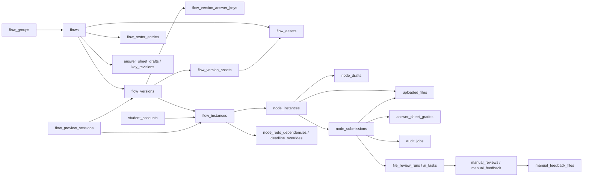

# 数据库表现状说明

核对时间：2026-10-15 20:01:17（Asia/Shanghai）。

**当前本地数据库共有 47 张非 SQLite 内部表，本文逐表覆盖全部 47 张。** 按业务职责分为 8 组；按名称前缀统计，Flow 类 9 张、Node 类 4 张，其余 34 张，没有独立的 `workflow_*` 表。业务分组与名称前缀是两种统计口径，不能相加。

本次依据根目录 [MEMORY.md](../MEMORY.md) 的事实来源顺序，以当前源码和 `backend/storage/app.db` 为准。结构、约束及索引以 SQLite 实际定义为准；本次结构调整已提前备份，事务内与备份逐表比较，确认保留表的结构和业务记录未变，仅新增迁移标记；外键与完整性检查通过。结构核对包括基础建表和初始化增量迁移，不能只看 `database.py` 中的初始 `CREATE TABLE`。

行数均为上述时点的快照，包含归档、停用、过期及历史记录，不代表活跃业务量。0 行表示当时无记录；是否仍有业务用途，需要结合读写代码判断。本次已同步数据库结构、后端清理逻辑与文档；未运行测试或浏览器验证。

## 1. 全表概览

| 业务分组 | 表数 | 保存的主要内容 |
| --- | ---: | --- |
| 账号、登录与注册 | 8 | 身份、会话、注册准入及密码找回 |
| 流程定义、分组与准入 | 4 | 流程/模板定义、版本、分组及名单 |
| 学生运行、输入与进度 | 7 | 流程实例、节点状态、暂存、提交、返工与个别延期 |
| 文件资源与下载 | 5 | 教师资源、版本引用、学生文件、下载与个人文件 |
| 答题卡答案与成绩 | 5 | 私有答案、答案修订、成绩及保留的历史成绩结构 |
| 审核任务、人工处理与反馈 | 11 | 自动审核、步骤进度、人工结论和反馈材料 |
| 审核脚本运行与模型配置 | 3 | 脚本状态、模型连接卡及兼容绑定结构 |
| 系统审计与后台任务 | 4 | 操作记录、迁移标记、导出及删除清理任务 |
| **合计** | **47** | 每张表只归入一个业务分组 |

相关代码：[database.py](../backend/app/core/database.py)、[sms_recovery.py](../backend/app/services/sms_recovery.py)、[model_ownership.py](../backend/app/services/model_ownership.py)、[flow_template_migration.py](../backend/app/core/flow_template_migration.py)。

## 2. 当前各表的职责与关联

### 2.1 账号、登录与注册：8 张

| 表名 | 行数 | 一条记录表示什么 | 当前职责、关联与约束 |
| --- | ---: | --- | --- |
| `teacher_accounts` | 4 | 一个教师或超级管理员账号 | 保存工号、姓名、密码 hash、角色、状态、手机号及强制改密标志；工号唯一，非空手机号在教师表内唯一。当前 1 名超级管理员、3 名教师。 |
| `student_accounts` | 127 | 一个正式或预览学生账号 | 保存学号、姓名、密码 hash、状态与手机号；学号唯一。`account_kind` 区分 normal/preview，预览账号通过 `preview_owner_teacher_id` 归属教师。 |
| `teacher_sessions` | 16 | 一次教师登录会话 | 关联教师账号，保存唯一令牌 hash、有效期与创建时间；同一教师可有多条会话记录。 |
| `student_sessions` | 399 | 一次学生登录会话 | 关联学生账号，保存唯一令牌 hash、有效期与创建时间；记录数不代表在线人数。 |
| `teacher_invitations` | 7 | 一次教师注册邀请 | 保存工号、姓名、令牌 hash、有效期及 active/used/expired/revoked 状态；同一工号最多一条 active 邀请，使用后关联教师账号。 |
| `registration_allowlist` | 373 | 一条学生注册准入信息 | 保存班级、学号和姓名；允许导入待补全记录，非空学号唯一。用于注册资格，与具体流程的学生名单分开。 |
| `sms_challenges` | 2 | 一次短信验证请求 | 按角色、用途、账号和手机号记录验证码验证流程、过期时间、尝试次数及状态；`recovery_hash` 关联找回流程。验证码核验由短信服务完成，本表没有验证码明文字段。 |
| `password_recoveries` | 2 | 一次密码找回流程 | 以找回令牌 hash 为主键，保存账号识别、手机号核验、密码版本、有效期与重置令牌 hash；角色与账号由应用校验，没有跨账号表外键。 |

相关代码：[auth.py](../backend/app/api/routes/auth.py)、[flow_previews.py](../backend/app/repositories/flow_previews.py)、[security.py](../backend/app/services/security.py)、[teacher_invitations.py](../backend/app/repositories/teacher_invitations.py)、[registration_allowlist.py](../backend/app/repositories/registration_allowlist.py)、[sms_recovery.py](../backend/app/services/sms_recovery.py)。

### 2.2 流程定义、分组与准入：4 张

| 表名 | 行数 | 一条记录表示什么 | 当前职责、关联与约束 |
| --- | ---: | --- | --- |
| `flow_groups` | 3 | 某教师创建的一个流程分组 | `(owner_teacher_id, name)` 唯一；支持空组，`flows.group_id` 引用本表。仍有流程引用时不能删除，包括归档流程。 |
| `flows` | 31 | 一个普通流程或固定流程模板 | 保存名称、简介、归属、生命周期、分组及 `draft_config`；`kind` 区分 normal/template，`is_shared` 控制模板上架。节点定义及当前参数在 JSON 中，不单独建节点定义表。 |
| `flow_versions` | 33 | 普通流程的一次发布或预览版本 | `(flow_id, version_no)` 唯一；保存 `config_snapshot`、hash、发布人和状态。快照实际仍包含节点配置，并非只存拓扑；正式运行按白名单叠加当前参数。 |
| `flow_roster_entries` | 375 | 某流程对某学号的一条准入记录 | `(flow_id, student_no)` 唯一；保存姓名、学号及 active/revoked 状态。学生正式访问持续校验名单，不能用是否已有执行实例代替授权。 |

相关代码：[workflow_groups.py](../backend/app/repositories/workflow_groups.py)、[workflows.py](../backend/app/repositories/workflows.py)、[workflow_blueprints.py](../backend/app/repositories/workflow_blueprints.py)、[flow_runtime_state.py](../backend/app/repositories/flow_runtime_state.py)、[flow_roster.py](../backend/app/repositories/flow_roster.py)、[database.py](../backend/app/core/database.py)、[user_deletion.py](../backend/app/repositories/user_deletion.py)。

### 2.3 学生运行、输入与进度：7 张

| 表名 | 行数 | 一条记录表示什么 | 当前职责、关联与约束 |
| --- | ---: | --- | --- |
| `flow_instances` | 233 | 一个学生在一个版本下的执行实例 | `(flow_version_id, student_account_id)` 唯一；保存整体状态、开始/完成/活动时间，正式进入时按需创建。预览也使用这张表。 |
| `flow_preview_sessions` | 1 | 某教师的一次学生视角预览会话 | 关联教师、预览学生、流程、版本和实例；教师、版本、实例分别唯一。保存预览令牌 hash、有效期及 active/cleaning 状态，负责临时授权与清理。 |
| `node_instances` | 1,079 | 一个学生流程实例中的一个节点状态 | `(flow_instance_id, node_key)` 唯一；保存开放、提交、通过时间、尝试次数、重置基线及或节点胜出前驱。节点定义通过 `node_key` 对应配置中的稳定节点 ID。 |
| `node_drafts` | 10 | 一个节点实例当前暂存的学生输入 | 以 `node_instance_id` 为主键，一节点实例至多一份 `payload`；暂存覆盖，成功提交后删除，部分进度撤销场景可从提交恢复。 |
| `node_submissions` | 500 | 某学生节点实例的一次正式提交 | 保存 `payload_snapshot`、尝试编号、幂等键、状态和提交时间；节点内尝试编号、幂等键分别唯一。审核与成绩以提交 ID 关联，状态可随处理结果更新。 |
| `node_redo_dependencies` | 35 | 一个学生流程实例中一条返工等待关系 | 主键为 `(flow_instance_id, source_node_key, target_node_key)`；记录目标节点需要等待哪个源节点重新完成，参与路径及进度判断。 |
| `student_deadline_overrides` | 2 | 某学生流程实例中某节点的个别截止时间 | `(flow_instance_id, node_key)` 为主键；保存截止时间、原因及操作人，正式运行优先于节点统一截止时间。 |

相关代码：[flow_instances.py](../backend/app/repositories/flow_instances.py)、[flow_previews.py](../backend/app/repositories/flow_previews.py)、[node_progress.py](../backend/app/repositories/node_progress.py)、[branch_state.py](../backend/app/repositories/branch_state.py)、[flow_runtime_state.py](../backend/app/repositories/flow_runtime_state.py)。

### 2.4 文件资源与下载：5 张

| 表名 | 行数 | 一条记录表示什么 | 当前职责、关联与约束 |
| --- | ---: | --- | --- |
| `flow_assets` | 167 | 教师为某流程节点保存的一份资源 | 保存 OSS 对象键、文件名、类型、大小、hash、创建人及归属。`asset_kind` 为 template/content/announcement；`storage_key` 唯一，实际文件内容不在数据库中。 |
| `flow_version_assets` | 107 | 某版本某节点对一份资源的冻结引用 | 主键为版本、节点、类别与资源的组合；组合外键同时约束资源 ID 和类别，部分唯一索引限制每版本每节点一个主模板。不是所有 JSON 资源引用的总索引。 |
| `uploaded_files` | 401 | 学生上传的一份原始文件或扫描材料 | 关联学生、节点实例，可关联正式提交；上传时 `submission_id` 可为空。保存 OSS 元数据、页数和显示顺序，`storage_key` 唯一。 |
| `template_download_events` | 44 | 某节点实例对某份主模板的下载记录 | `(node_instance_id, template_asset_id)` 为主键；保存学生与下载时间，资源类别限定为 template。不是每次下载都追加一行的访问日志。 |
| `personal_drive_files` | 0 | 教师个人文件区的一份文件 | 关联教师，保存 OSS 对象键及文件元数据；`storage_key` 唯一。与流程节点资源和学生提交文件分开管理。 |

相关代码：[flow_assets.py](../backend/app/repositories/flow_assets.py)、[flow_templates.py](../backend/app/repositories/flow_templates.py)、[flow_content_assets.py](../backend/app/repositories/flow_content_assets.py)、[flow_announcement_files.py](../backend/app/repositories/flow_announcement_files.py)、[flow_files.py](../backend/app/repositories/flow_files.py)、[routes/personal_drive.py](../backend/app/api/routes/personal_drive.py)、[repositories/personal_drive.py](../backend/app/repositories/personal_drive.py)。

### 2.5 答题卡答案与成绩：5 张

| 表名 | 行数 | 一条记录表示什么 | 当前职责、关联与约束 |
| --- | ---: | --- | --- |
| `answer_sheet_drafts` | 32 | 某流程某答题卡节点的私有标准答案配置 | `(flow_id, node_key)` 为主键；保存 `grading_config`、hash 和更新人/时间。固定流程模板也复用本表，答案不混入学生可见的节点配置。 |
| `flow_version_answer_keys` | 20 | 某版本某答题卡的冻结标准答案 | `(flow_version_id, node_key)` 为主键；保存答案快照与 hash。预览使用自身冻结答案；正式评分无后续修订时也使用本表。 |
| `answer_sheet_key_revisions` | 1 | 某流程某答题卡的一次标准答案修订 | 主键为流程、节点及代次；正式评分优先选择最新修订，历史判分依据可按 hash 解析。答案保存接口同时更新 `answer_sheet_drafts`。 |
| `answer_sheet_grades` | 232 | 一次答题卡正式提交对应的持久化成绩 | 以 `submission_id` 为主键，保存分数、总分、判分版本、答案 hash 及结果快照。当前提交时计算并写入，查看与导出读取已存结果。`passing_score` 当前写入 0，用于兼容既有列。 |
| `answer_sheet_grade_history` | 0 | 一份曾被替换的成绩副本 | 保存原成绩及替换人、替换时间。当前保留建表和 `replace_answer_sheet_grade()` 写入函数，但未发现该函数的现行业务调用；答案更新接口不触发历史重判，不能据此称系统正在记录每次重判历史。 |

相关代码：[answer_sheet_keys.py](../backend/app/repositories/answer_sheet_keys.py)、[answer_sheet_policies.py](../backend/app/repositories/answer_sheet_policies.py)、[answer_sheet_grades.py](../backend/app/repositories/answer_sheet_grades.py)、[flow_instances.py](../backend/app/repositories/flow_instances.py)、[teacher_node_exports.py](../backend/app/repositories/teacher_node_exports.py)。

### 2.6 审核任务、人工处理与反馈：11 张

| 表名 | 行数 | 一条记录表示什么 | 当前职责、关联与约束 |
| --- | ---: | --- | --- |
| `audit_jobs` | 0 | 一次正式提交对应的单脚本审核任务 | `submission_id` 唯一；保存脚本代次/hash、参数代次/hash、执行参数/设置、任务状态、重试信息和结果。任务领取、失败重试及恢复均依赖本表。 |
| `file_review_runs` | 212 | 一次提交的多步骤审核执行进度 | 以 `submission_id` 为主键；`steps_json` 保存步骤信息，`step_index` 指示当前步骤，状态为 active/completed/rejected/cancelled。 |
| `file_review_ai_tasks` | 208 | 一次提交中某个 AI 审核步骤的任务 | `(submission_id, step_index)` 唯一；保存步骤执行快照、任务状态、尝试次数与结果。领取对应步骤时读取运行配置中的当前参数，写回实际执行快照。 |
| `manual_reviews` | 183 | 教师对一组材料作出的一次正式审核 | 保存流程实例、节点、材料 hash、`evidence_snapshot`、教师、评语及时间；当前审核结论包含在证据快照中。与反馈文件和暂存内容分开。 |
| `manual_feedback_drafts` | 199 | 某节点实例当前暂存的教师反馈文件选择 | 以 `node_instance_id` 为主键；保存材料 hash、修改代次和文件 ID 列表。材料变化及并发修改由 hash/代次检查。 |
| `manual_feedback_files` | 0 | 教师上传的一份批改反馈文件 | 保存所属实例/节点、材料 hash、原文件标识、文件名、OSS 对象键和大小；与学生原始文件分开保存。 |
| `manual_feedback` | 180 | 一份正式发布的教师反馈 | `(node_instance_id, revision)` 唯一；保存材料 hash、文件 ID 列表、评语和发布时间，学生按可见性规则读取。 |
| `file_review_feedback_context` | 180 | 一份正式反馈对应的审核提交与步骤 | 以 `feedback_id` 为主键，关联 `manual_feedback` 和 `node_submissions`，保存 `step_index`；用于区分反馈属于哪次提交、哪个步骤。 |
| `manual_source_reviews` | 0 | 一条按材料来源节点记录的人工审核记录 | 主键为节点实例、材料 hash 与来源节点。当前保留版本迁移读取和账号清理依赖，应用源码未发现新增记录的常规写入入口。 |
| `manual_node_rejections` | 0 | 一条针对学生节点某次尝试的人工退回记录 | 保存目标节点、审核节点、反馈、尝试编号、教师与说明；当前仍有退回信息读取及版本迁移/清理代码，应用源码未发现新增记录的常规写入入口。 |
| `teacher_review_remarks` | 11 | 某教师的一条常用审核评语 | 保存默认槽位和内容，`(teacher_id, default_index)` 唯一；删除采用清空内容保留槽位，因此行数可包含已隐藏评语。 |

相关代码：[audit_jobs.py](../backend/app/repositories/audit_jobs.py)、[audit_job_worker.py](../backend/app/services/audit_job_worker.py)、[file_reviews.py](../backend/app/repositories/file_reviews.py)、[file_review_tasks.py](../backend/app/repositories/file_review_tasks.py)、[manual_reviews.py](../backend/app/repositories/manual_reviews.py)、[manual_feedback.py](../backend/app/repositories/manual_feedback.py)、[workflows.py](../backend/app/repositories/workflows.py)、[manual_review_state.py](../backend/app/repositories/manual_review_state.py)、[user_deletion.py](../backend/app/repositories/user_deletion.py)、[review_remarks.py](../backend/app/repositories/review_remarks.py)。

### 2.7 审核脚本运行与模型配置：3 张

| 表名 | 行数 | 一条记录表示什么 | 当前职责、关联与约束 |
| --- | ---: | --- | --- |
| `audit_script_runtime_states` | 8 | 一个审核脚本的当前运行状态 | 以 `script_id` 为主键；保存运行代次、代码/来源/配置 hash、并发上限及 ready/updating/error 状态。脚本源码和配置文件在仓库中，本表不保存完整脚本。 |
| `audit_model_cards` | 7 | 某教师的一张模型连接卡 | 保存供应商、接口地址、模型、加密 API 凭据、思考配置及加密账单凭据；通过 `owner_teacher_id` 归属教师。节点保存模型卡 ID，不复制密钥。 |
| `audit_model_bindings` | 0 | 一条旧的教师—脚本—模型卡绑定 | 主键为 `(owner_teacher_id, script_id)`，组合外键要求模型卡属于该教师。当前保留初始化迁移及账号清理依赖，节点执行使用节点内的 `auditModelCardId`，不以本表作为当前绑定来源。 |

相关代码：[audit_script_runtime.py](../backend/app/services/audit_script_runtime.py)、[audit_script_catalog.py](../backend/app/services/audit_script_catalog.py)、[audit_model_connections.py](../backend/app/services/audit_model_connections.py)、[node_models.py](../backend/app/services/node_models.py)、[model_ownership.py](../backend/app/services/model_ownership.py)、[user_deletion.py](../backend/app/repositories/user_deletion.py)。

### 2.8 系统审计与后台任务：4 张

| 表名 | 行数 | 一条记录表示什么 | 当前职责、关联与约束 |
| --- | ---: | --- | --- |
| `audit_logs` | 2,038 | 一次业务操作或执行依据记录 | 保存操作者、动作、实体标识、前后 JSON、原因和时间；也记录审核实际执行依据、进度重置等信息。通用实体标识由应用解释，没有指向所有业务表的统一外键。 |
| `schema_migrations` | 20 | 一项已执行的数据库迁移标记 | 以迁移 ID 为主键，保存应用时间，用于初始化时避免重复迁移；不是普通业务数据。 |
| `material_export_jobs` | 5 | 教师对某发布版本发起的一次材料导出任务 | 保存任务状态、文件名、错误、完成/过期/已读时间；同一教师和版本最多一个 pending/running 任务。导出文件内容不保存在本表中。 |
| `user_deletion_jobs` | 11 | 账号删除后的一个 OSS 文件清理任务 | 保存待清理对象键列表、状态和错误；数据库内账号数据删除与外部文件清理分开执行，worker 更新剩余对象键及清理结果。 |

相关代码：[workflows.py](../backend/app/repositories/workflows.py)、[node_progress.py](../backend/app/repositories/node_progress.py)、[audit_jobs.py](../backend/app/repositories/audit_jobs.py)、[database_admin.py](../backend/app/repositories/database_admin.py)、[database.py](../backend/app/core/database.py)、[flow_consolidation.py](../backend/app/core/flow_consolidation.py)、[node_configuration_migration.py](../backend/app/core/node_configuration_migration.py)、[flow_template_migration.py](../backend/app/core/flow_template_migration.py)、[export_jobs.py](../backend/app/repositories/export_jobs.py)、[export_job_worker.py](../backend/app/services/export_job_worker.py)、[user_deletion.py](../backend/app/repositories/user_deletion.py)、[user_deletion_worker.py](../backend/app/services/user_deletion_worker.py)。

## 3. 当前配置、模板与学生数据如何连接

### 3.1 流程配置和发布快照

`flows.draft_config` 是流程定义 JSON，核心结构为 `nodes` 和 `edges`。节点内保存类型、标题、表单或题目结构、资源引用、审核脚本标识及参数、多步骤审核配置等；`_configMeta` 保存参数修改代次、修改人和时间，不另存一份参数值。当前没有独立的节点定义表、节点普通参数表或节点审核策略表。

正式学生运行时，后端先读取 `flow_versions.config_snapshot`，以版本确定节点、连线和固定结构，再按稳定节点 ID，从同一流程的 `draft_config` 叠加白名单允许的当前字段。可变字段包括适用节点的标题、说明、时间、参考文件，以及符合脚本/步骤结构校验的审核参数和模型卡引用。新增节点不会因修改草稿直接出现在旧版本中，需要发布；条件分支的普通字段仍走修订发布路径。

**当前快照仍保存节点配置，并未精简成只含拓扑的 JSON，也不是数据库字段直接指向另一个 JSON 字段。** “使用最新参数”由后端读取与合并逻辑实现。预览不叠加正式流程当前参数，读取自己的快照；正式学生的个别截止时间还会优先读取 `student_deadline_overrides`。

本次快照中，`flow_versions` 共 33 条：published 13 条、disabled 19 条，preview 1 条；`flow_preview_sessions` 当前为 1 条。

### 3.2 固定流程模板

| 字段或存储位置 | 当前规则 |
| --- | --- |
| `flows.kind` | 默认 normal；template 表示固定流程模板 |
| `flows.is_shared` | 默认 0；仅 template 可以设为 1，表示上架 |
| `flows.status` | 与类型分开；模板归档后不出现在模板列表，上下架通过 `is_shared` 控制 |
| `flows.owner_id` | 新模板保存创建者；旧归档定义可能仍保留原模板命名空间归属 |
| `flows.draft_config` | 模板自己的固定内容；模板发布后不能原地编辑 |
| `flow_assets`、`answer_sheet_drafts` | 按模板自身 `flow_id` 保存独立附件和私有答案 |

相关代码：[routes/workflow_blueprints.py](../backend/app/api/routes/workflow_blueprints.py)、[repositories/workflow_blueprints.py](../backend/app/repositories/workflow_blueprints.py)、[workflows.py](../backend/app/repositories/workflows.py)。

当前共有 31 条流程定义：24 条普通流程（draft 7、published 13、archived 4），7 条模板（均为 archived、未上架）。当前无可见模板不等于模板功能已移除。

超级管理员从本人普通流程发布模板时，创建独立定义和资源副本，清空起止时间与私人模型引用，不复制学生名单、实例和提交。使用上架模板会创建教师自己的普通草稿，后续修改互不影响。固定模板只支持上下架或归档；修改内容需要复制、编辑后发布新模板。

模板发布不创建学生运行版本，`flow_versions` 不承担模板库版本链的职责。当前源码中的 `workflow_blueprints.py` 等模块名和 `/api/workflow-templates` 接口名仍保留，但不代表数据库中存在同名表。

### 3.3 学生状态、暂存和提交

| 数据层 | 表 | 回答的问题 |
| --- | --- | --- |
| 准入资格 | `flow_roster_entries` | 这个学生是否有权进入该流程？ |
| 流程进度 | `flow_instances` | 这个学生在该版本下进行到什么状态？ |
| 节点进度 | `node_instances` | 这个节点是否开放、已提交、通过或需要返工？ |
| 尚未提交的输入 | `node_drafts` | 学生现在暂存了什么？ |
| 正式输入 | `node_submissions` | 这次正式提交了什么、属于第几次尝试？ |
| 输入中的文件 | `uploaded_files` | 对应的原始文件存放在哪里、是否已关联提交？ |
| 处理过程与输出 | 审核任务、人工审核、反馈和成绩表 | 谁按什么依据处理了这次提交，结果是什么？ |

相关代码：[flow_roster.py](../backend/app/repositories/flow_roster.py)、[flow_instances.py](../backend/app/repositories/flow_instances.py)、[flow_files.py](../backend/app/repositories/flow_files.py)、[audit_jobs.py](../backend/app/repositories/audit_jobs.py)、[file_reviews.py](../backend/app/repositories/file_reviews.py)、[answer_sheet_grades.py](../backend/app/repositories/answer_sheet_grades.py)。

这些数据通过流程版本、实例、节点实例和提交 ID 关联。节点配置中的稳定 ID 与学生节点状态表的 `node_key` 对应；节点标题不是关联键。暂存内容、正式提交和当前状态具有不同生命周期。

### 3.4 教师资源、参考示例与学生文件

`flow_assets.asset_kind='template'` 包括节点的主模板和参考材料，不表示“流程模板库中的一条模板”。`content` 用于正文或题目图片，`announcement` 用于公告附件。当前三类资源分别为 157、9、1 条。

`flow_version_assets` 保存版本冻结引用，当前三类引用分别为 86、14、7 条。当前配置中的参考材料等引用还存在于 JSON 中，资源归属和是否可删除不能只查这一张关联表。教师提供的文件、学生上传的原件、教师反馈文件分别由 `flow_assets`、`uploaded_files`、`manual_feedback_files` 管理；数据库保存元数据，文件内容在 OSS。

### 3.5 标准答案、成绩和审核执行依据

答题卡的题目和公开配置位于节点 JSON；私有标准答案由 `answer_sheet_drafts`、`flow_version_answer_keys`、`answer_sheet_key_revisions` 保存。正式提交按当前生效答案计算成绩，并写入 `answer_sheet_grades`。

**当前学生查看成绩及教师导出时读取已保存成绩，不是在每次查看时用最新答案重新计算。** 当前答案更新接口保存新答案及修订，返回的重判数量为 0，不改写已有成绩；历史答案可按判分 hash 解析。`answer_sheet_grade_history` 当前为空，其写入辅助函数仍在源码中，但没有发现现行业务调用。

审核配置与审核执行记录同样分开：节点 JSON 保存当前参数，`audit_jobs` 或 `file_review_ai_tasks` 保存执行时采用的参数与结果。相关任务领取时读取适用的当前参数，执行依据还写入 `audit_logs`；不能把已保存的执行快照理解为永远等于教师当前配置。

## 4. 当前保留的兼容结构

下列判断来自当前源码引用与调用链，不仅依据行数；这里只描述现状，不提出删表方案。

| 表 | 当前保留情况 |
| --- | --- |
| `audit_model_bindings` | 0 条；保留初始化迁移和账号清理依赖，当前模型选择直接记录在节点配置中 |
| `manual_source_reviews` | 0 条；保留版本迁移读取与清理依赖，未发现常规新增入口 |
| `manual_node_rejections` | 0 条；保留退回信息读取、版本迁移及清理依赖，未发现常规新增入口 |
| `answer_sheet_grade_history` | 0 条；保留表结构、管理/清理依赖及写入辅助函数，当前答案保存不调用历史重判 |

相关代码：[workflows.py](../backend/app/repositories/workflows.py)、[node_models.py](../backend/app/services/node_models.py)、[manual_review_state.py](../backend/app/repositories/manual_review_state.py)、[answer_sheet_grades.py](../backend/app/repositories/answer_sheet_grades.py)、[user_deletion.py](../backend/app/repositories/user_deletion.py)。

数据库外键只覆盖显式声明的关系。JSON 中的资源 ID、节点 ID，以及 `flows.owner_id`、部分操作人和通用审计实体标识由应用维护；外键检查通过不能证明所有 JSON 引用或业务权限都有效。

## 5. 核心关系图

图示为核心业务关联，不代表全部外键或精确基数。`key_revisions`、`deadline_overrides`、`ai_tasks` 是空间所限的简写，完整表名见第 2 节；固定流程模板属于 `flows` 中的一类记录，不另设模板表。

## 6. 源码核对入口

| 范围 | 主要源码 |
| --- | --- |
| 建表及初始化迁移 | [database.py](../backend/app/core/database.py)、[flow_consolidation.py](../backend/app/core/flow_consolidation.py)、[flow_template_migration.py](../backend/app/core/flow_template_migration.py)、[sms_recovery.py](../backend/app/services/sms_recovery.py)、[model_ownership.py](../backend/app/services/model_ownership.py) |
| 流程、固定模板及运行配置 | [workflows.py](../backend/app/repositories/workflows.py)、[workflow_blueprints.py](../backend/app/repositories/workflow_blueprints.py)、[flow_runtime_state.py](../backend/app/repositories/flow_runtime_state.py)、[node_configuration.py](../backend/app/domain/node_configuration.py) |
| 名单、预览与学生节点 | [flow_roster.py](../backend/app/repositories/flow_roster.py)、[flow_previews.py](../backend/app/repositories/flow_previews.py)、[flow_instances.py](../backend/app/repositories/flow_instances.py)、[branch_state.py](../backend/app/repositories/branch_state.py) |
| 答案与成绩 | [answer_sheet_keys.py](../backend/app/repositories/answer_sheet_keys.py)、[answer_sheet_policies.py](../backend/app/repositories/answer_sheet_policies.py)、[answer_sheet_grades.py](../backend/app/repositories/answer_sheet_grades.py)、[teacher_node_exports.py](../backend/app/repositories/teacher_node_exports.py) |
| 审核与反馈 | [audit_jobs.py](../backend/app/repositories/audit_jobs.py)、[file_reviews.py](../backend/app/repositories/file_reviews.py)、[file_review_tasks.py](../backend/app/repositories/file_review_tasks.py)、[manual_feedback.py](../backend/app/repositories/manual_feedback.py)、[manual_review_state.py](../backend/app/repositories/manual_review_state.py) |
| 模型与脚本 | [audit_model_connections.py](../backend/app/services/audit_model_connections.py)、[node_models.py](../backend/app/services/node_models.py)、[audit_script_runtime.py](../backend/app/services/audit_script_runtime.py) |
| 后台任务及管理 | [export_jobs.py](../backend/app/repositories/export_jobs.py)、[user_deletion.py](../backend/app/repositories/user_deletion.py)、[user_deletion_worker.py](../backend/app/services/user_deletion_worker.py)、[database_admin.py](../backend/app/repositories/database_admin.py) |

相关代码：[router.py](../backend/app/api/router.py)、[main.py](../backend/app/main.py)。
