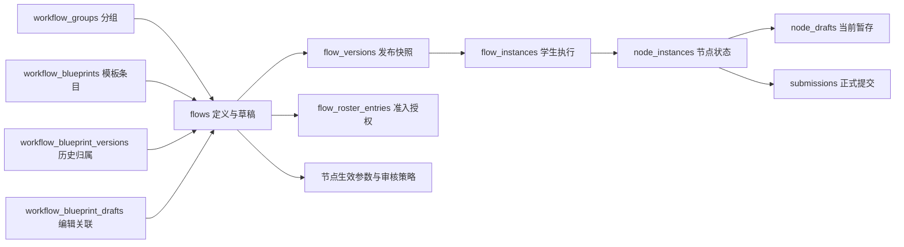

# 数据库表冗余、复用与精简审计

审计日期：2026-10-15。

文档范围：面向项目全部数据库表，统一记录冗余识别、表复用与结构精简建议，不限定表名前缀。

当前已完成范围：当前源码及本地 `backend/storage/app.db` 中名称以 `flow`、`node`、`workflow` 开头的表，包含 `flows` 主表。源码共声明 **23 张目标表**：Flow 类 13 张、Node 类 6 张、Workflow 类 4 张。本地实际存在 **22 张**，源码声明的 `node_form_parameters` 尚未出现在这份数据库中。其他前缀表仅用于判断职责边界，不代表已经完成全库审计。

审计方式：静态检查建表定义、业务读写与删除路径，使用 SQLite `mode=ro` 和 `query_only` 读取实际结构及聚合数据。未启动应用、未运行初始化或迁移、未修改数据库、未运行测试或浏览器验证。下述行数为查询时的本地数据快照，不代表其他部署环境。

依据根目录 [MEMORY.md](../MEMORY.md)，本次判断遵循：优先复用现有结构；名单授权与运行实例分离；保留发布依据和历史记录；任何数据库结构、已有数据或启动时迁移变更均需另行明确授权。

## 1. 先明确各表的职责和作用

### 1.1 Flow 类：流程定义、授权、执行和资源

| 表名 | 本地行数 | 一条记录表示什么 | 职责与主要读写场景 |
| --- | ---: | --- | --- |
| `flows` | 30 | 一个流程定义，主键为 `id` | 保存名称、所有者、草稿 JSON、分组及生命周期；设计器保存和流程复制使用。模板库也复用此表保存定义副本；`publishedNodeParameters` 在其中保存部分发布后参数 |
| `flow_versions` | 33 | 某流程的一次发布或预览，`(flow_id, version_no)` 唯一 | 冻结配置及 hash；发布、重新发布和预览写入，实例与资源关联读取它；33 条中停用 19、正式发布 13、预览 1 |
| `flow_instances` | 233 | 一个学生在一个版本中的执行实例 | `(flow_version_id, student_account_id)` 唯一；学生进入时创建，记录整体完成状态和活动时间，承载多个节点实例 |
| `flow_roster_entries` | 375 | 某流程对一个学号的准入授权 | `(flow_id, student_no)` 唯一；名单导入、撤销和持续访问校验使用；当前有效 364 条、撤销 11 条 |
| `flow_preview_sessions` | 1 | 某教师的一次学生视角预览会话 | 关联教师、虚拟学生、版本和实例，保存令牌 hash、有效期及清理状态；每位教师最多一个会话 |
| `flow_version_answer_keys` | 20 | 某版本某答题卡的私有标准答案 | `(flow_version_id, node_key)` 唯一；发布或预览时冻结，评分、预览和历史评分依据解析时读取 |
| `flow_node_runtime_configs` | 263 | 某版本某节点的统一截止时间记录 | 发布时写入 `deadline_at`，运行时覆盖快照；管理员数据编辑可修改，其他发布后参数会进一步覆盖它 |
| `flow_template_assets` | 145 | 教师为某流程节点上传的一份模板或参考材料 | 保存 OSS 键、类型、大小、hash 和归属；上传、复制、下载、文件名校验和资源清理使用 |
| `flow_content_assets` | 8 | 某节点正文引用的一张图片 | 保存答题卡题图或公告图片元数据；通过 `asset://` 引用，上传和下载时检查节点归属 |
| `flow_announcement_files` | 1 | 某公告节点引用的一份附件 | 保存公告 PDF 或 Office 文件元数据；上传、发布验证、复制和下载使用 |
| `flow_version_templates` | 96 | 某版本某节点所选的主模板 | `(flow_version_id, node_key)` 唯一，每节点最多一个；用于下载、校验和删除保护；不记录参考材料列表 |
| `flow_version_content_assets` | 14 | 某版本某节点引用的一张正文图片 | 按版本、节点、资源去重，允许多张；发布冻结、已发布图片删除保护和版本资源查询使用 |
| `flow_version_announcement_files` | 6 | 某版本某节点引用的一份公告附件 | 按版本、节点、资源去重，允许多份；发布或预览冻结，外键限制被引用附件的删除 |

主要依据：[workflows.py](../backend/app/repositories/workflows.py)、[flow_instances.py](../backend/app/repositories/flow_instances.py)、[flow_roster.py](../backend/app/repositories/flow_roster.py)、[flow_previews.py](../backend/app/repositories/flow_previews.py)、[answer_sheet_keys.py](../backend/app/repositories/answer_sheet_keys.py)、[flow_templates.py](../backend/app/repositories/flow_templates.py)、[flow_content_assets.py](../backend/app/repositories/flow_content_assets.py)、[flow_announcement_files.py](../backend/app/repositories/flow_announcement_files.py)。

### 1.2 Node 类：节点实例、暂存、返工和教师参数

| 表名 | 本地行数 | 一条记录表示什么 | 职责与主要读写场景 |
| --- | ---: | --- | --- |
| `node_instances` | 1,092 | 一个学生流程实例中的一个节点 | `(flow_instance_id, node_key)` 唯一；记录状态、开放/提交/通过时间、尝试次数、重置基线和或节点胜出前驱；提交、审核、分支推进和教师撤销通过都会使用 |
| `node_drafts` | 10 | 一个节点实例当前尚未正式提交的输入 | 主键直接为 `node_instance_id`，一对零或一；暂存时覆盖，成功提交时删除；撤销通过时可从旧提交恢复草稿 |
| `node_redo_dependencies` | 0 | 某学生实例中，一次返工要求形成的“源节点重新通过后，目标才可继续”关系 | 主键为实例、源节点、目标节点；教师撤销通过时写入，运行路径判断读取，源节点重新通过后清理；不是流程定义中的固定连线 |
| `node_audit_policies` | 2 | 某流程节点的独立脚本审核生效策略 | 保存脚本 ID、参数、模型卡、修改代次、策略 hash、修改人和时间；发布或预览初始化，教师修改，审核任务领取与有效性判断读取 |
| `node_form_parameters` | 缺表 | 某流程表单节点发布后的共享可变参数 | 源码主键为 `(flow_id, node_key)`；保存标题、说明、开始/截止时间及修改代次；表单参数接口写入，运行配置读取；本地不是“0 行”，而是没有这张表 |
| `node_review_step_policies` | 7 | 某流程节点多步骤审核中的 AI 步骤参数覆盖 | 主键为 `(flow_id, node_key)`；`steps_json` 保存步骤 ID、脚本 ID、参数和模型卡；修改接口保留步骤结构，仅改变参数，审核执行读取生效步骤 |

主要依据：[flow_instances.py](../backend/app/repositories/flow_instances.py)、[manual_review_state.py](../backend/app/repositories/manual_review_state.py)、[node_progress.py](../backend/app/repositories/node_progress.py)、[branch_state.py](../backend/app/repositories/branch_state.py)、[audit_policies.py](../backend/app/repositories/audit_policies.py)、[form_parameters.py](../backend/app/repositories/form_parameters.py)、[review_step_policies.py](../backend/app/repositories/review_step_policies.py)。

### 1.3 Workflow 类：分组与流程模板库

| 表名 | 本地行数 | 一条记录表示什么 | 职责与主要读写场景 |
| --- | ---: | --- | --- |
| `workflow_groups` | 3 | 某教师创建的一个流程分组 | 同一教师下组名唯一；支持独立创建、改名、删除，`flows.group_id` 关联它；只允许删除没有流程引用的组 |
| `workflow_blueprints` | 0 | 模板库中的一个模板条目 | 保存模板名称、简介、上/下架状态、创建人和当前 `snapshot_flow_id`；内容实际复用 `flows`，不在本表重复保存节点 JSON |
| `workflow_blueprint_drafts` | 0 | 某管理员对某模板正在进行的一次编辑 | `(blueprint_id, teacher_id)` 唯一；关联可编辑的 `flows` 副本和编辑基线，支持恢复草稿、并发冲突检测、发布或放弃；正常流程列表会排除这些草稿 |
| `workflow_blueprint_versions` | 0 | 某模板曾发布过的一个定义副本 | 关联模板与历史 `snapshot_flow_id`，记录发布人和时间；每次模板发布追加，删除模板或账号时用于定位历史定义归属 |

主要依据：[workflow_groups.py](../backend/app/repositories/workflow_groups.py)、[workflow_blueprints.py](../backend/app/repositories/workflow_blueprints.py)、[模板路由](../backend/app/api/routes/workflow_blueprints.py)、[user_deletion.py](../backend/app/repositories/user_deletion.py)。模板路由已注册到 `/api/workflow-templates`；空表不能证明功能未接入。

### 1.4 关系边界



图中箭头表示业务关联，不表示外键方向或全部基数。需要区分“相同实体被重复保存”与“不同阶段需要独立记录”：流程定义、学生实例、当前暂存、正式提交即使包含类似信息，也不具有相同生命周期。

结构核对以 [database.py](../backend/app/core/database.py) 和实际 SQLite 表定义为准；例如 `node_audit_policies.model_card_id` 来自 [node_models.py](../backend/app/services/node_models.py) 的迁移，不能仅查看初始建表字符串。

## 2. 当前建议的第一批精简范围

**第一批只纳入以下四组，目标是在保留现有功能的前提下整合存储。当前没有可以不改依赖、不迁移数据就直接删除的现存表。**

### 2.1 第一批：替代方向已明确的四组

| 涉及的表 | 建议操作 | 必须保留的能力与迁移条件 |
| --- | --- | --- |
| `flow_node_runtime_configs` | 取消独立表，统一使用发布快照默认值及发布后参数覆盖 | 保留统一截止时间、个人延期和预览隔离；迁移前核对目标库中不同于快照的值，处理版本作用域与流程节点作用域的差别 |
| `node_form_parameters` | 表单参数并入现有 `publishedNodeParameters` 机制，取消专用表设计 | 保留修改代次、并发校验和审计记录；普通草稿修改不能直接影响正式流程；缺表环境与已有表环境分别处理 |
| `flow_template_assets`、`flow_content_assets`、`flow_announcement_files` | 三表合一，统一教师资源元数据存储 | 保留各用途的类型、大小和数量限制，教师及节点归属、资源 ID、下载与删除保护 |
| `flow_version_templates`、`flow_version_content_assets`、`flow_version_announcement_files` | 三表合一，统一版本资源关联 | 保留主模板最多一个、图片与附件允许多个、历史引用、外键约束和清理语义；与资源合并配套实施 |

四组共涉及 8 张源码声明的表。资源与关联各保留一张，可变参数复用已有 JSON 区域、不另建配置表时，**源码声明的 23 张可收敛为 17 张；本地审计时现存的 22 张可收敛为 17 张**。差异来自本地尚无 `node_form_parameters`，不能将它重复计入物理删表数量。

“可纳入第一批”表示职责与替代方向已经比较清楚，不表示迁移已验证安全，更不表示可以直接执行删表。需要先完成数据迁移、代码依赖替换与相应验证，再移除旧结构。

### 2.2 暂缓项与保留项

| 对象 | 当前决定 | 原因 |
| --- | --- | --- |
| `workflow_blueprints`、`workflow_blueprint_drafts`、`workflow_blueprint_versions` | 暂缓合并，不纳入第一批 | 模板应复用流程模型，但需先明确“编辑草稿—稳定共享版本—独立副本”的状态与数据映射；已有代码依赖不是必须永久保留三表的理由 |
| `node_audit_policies`、`node_review_step_policies` | 暂缓合并 | 先统一独立审核与多步骤审核的策略及执行契约，不能只合并 JSON 存储 |
| `node_drafts` | 保留 | 当前暂存与正式提交需要区分；内联节点实例虽然可行，但本轮收益较小 |
| `node_redo_dependencies`、`workflow_groups` | 保留 | 分别承载运行期返工依赖和独立分组实体，职责明确 |
| `flows`、`flow_versions`、`flow_instances`、`node_instances`、`flow_roster_entries`、`flow_preview_sessions`、`flow_version_answer_keys` | 保留 | 流程定义、版本、运行实例、授权、会话和私有答案具有不同生命周期与权限边界 |

**本轮推荐目标为 17 张，不将模板体系重构、审核策略统一或草稿内联捆绑进第一批，也不以更低表数作为设计目标。**本次授权仅为文档整理，未授权实施数据库变更。

以下逐项说明证据和迁移边界。

## 3. 截止时间表：独立存在的必要性最弱

### 3.1 实际重复情况

`flow_node_runtime_configs` 除主键和更新信息外，唯一业务字段是 `deadline_at`。

本地只读比对结果：

| 检查项 | 结果 |
| --- | ---: |
| 运行配置记录总数 | 263 |
| 与对应版本快照的 `deadlineAt` 完全一致 | 263 |
| 与快照不同 | 0 |
| `deadline_at` 为 SQL `NULL` | 205 |
| 对应节点在版本快照中不存在 | 0 |

这说明当前本地数据中，该表没有提供快照之外的截止时间信息。它也为没有设置截止时间的节点保存了记录。

### 3.2 当前代码职责重叠

发布流程时，[workflows.py](../backend/app/repositories/workflows.py) 将节点的 `deadlineAt` 逐条写入运行配置表。[flow_runtime_state.py](../backend/app/repositories/flow_runtime_state.py) 的 `version_config()` 按以下顺序构建生效配置：

1. 读取 `flow_versions.config_snapshot`。
2. 使用 `flow_node_runtime_configs` 覆盖截止时间。
3. 非预览版本应用 `node_form_parameters` 中的表单参数。
4. 非预览版本应用 `flows.draft_config.publishedNodeParameters` 中的其他节点参数。

学生个别延期另由 `student_deadline_overrides` 处理，在计算个人有效截止时间时优先使用。

因此，统一截止时间已经存在多条存储和覆盖路径。当前源码中没有发现面向教师的业务接口继续独立更新 `flow_node_runtime_configs`；但 [database_admin.py](../backend/app/repositories/database_admin.py) 仍允许超级管理员编辑其 `deadline_at`，不能把它描述为完全没有更新能力。

### 3.3 建议

将统一截止时间纳入现有发布后可变参数机制；未设置覆盖值时使用发布快照。学生个别延期继续保留在 `student_deadline_overrides`，因为它的作用对象和更新原因与统一截止时间不同。

取消该表前需要：

- 对目标数据库再次比较运行配置与快照，迁移真实存在的差异；不能假定其他环境同样没有差异。
- 处理“按版本覆盖”与“按流程稳定节点覆盖”的作用域差别，避免旧版本配置被错误提升为所有版本共用参数。
- 更新 `version_config()`、教师进度和延期查询、发布写入、删除清理及数据库管理白名单。
- 保留个人延期、预览隔离和既有学生状态；配置整理不能顺带重新审核或重置进度。

**判断：该表可作为取消候选；现阶段不能直接执行 `DROP TABLE`。**

## 4. 教师资源表：可以统一存储，保留业务规则

### 4.1 三张表结构高度重复

三表均包含以下 11 个字段：

```text
id, flow_id, node_key, storage_key, original_name, content_type,
size_bytes, sha256, etag, created_by, created_at
```

主要区别如下：

| 表 | 用途 | 当前约束差异 |
| --- | --- | --- |
| `flow_template_assets` | 主模板、参考材料 | 表级约束较宽，按节点及用途执行业务校验 |
| `flow_content_assets` | 正文图片 | PNG、JPEG、WebP；最大 5 MiB |
| `flow_announcement_files` | 公告附件 | PDF、DOCX、XLSX、PPTX；最大 50 MiB；业务层限制每公告最多 10 份 |

这些差异可以由明确的资源用途和相应验证逻辑表达，不要求三个独立存储模型。当前实现已经存在复用：参考材料与主模板共享 `flow_template_assets`；答题卡图片与公告图片共享 `flow_content_assets`。

源码依据：[flow_templates.py](../backend/app/repositories/flow_templates.py)、[flow_content_assets.py](../backend/app/repositories/flow_content_assets.py)、[flow_announcement_files.py](../backend/app/repositories/flow_announcement_files.py)。

### 4.2 建议的复用边界

可以基于现有教师资源表演进为统一资源存储，使用清晰的用途标识区分模板、参考材料、正文图片和公告附件；具体用途字段放在资源还是引用关系上，应在确认资源是否允许跨用途复用后确定。

统一后仍必须保留：

- 资源的流程、节点和教师归属校验。
- 各用途的文件类型、大小和数量限制，不能将合并理解为放宽上传规则。
- 稳定资源 ID、OSS 对象键和历史快照中的引用。
- 模板下载事件以及已发布引用的删除保护。

不建议直接借用 `uploaded_files`。它表示学生在某个节点实例上传、随后关联某次提交的文件，与教师在流程定义阶段上传的资源有不同所有者、主键关联和清理生命周期。强行复用会引入大量条件字段，削弱业务边界。

本地数据中，模板表有 34 组重复 `sha256`，正文图片表有 2 组。**相同文件内容不等于重复业务记录**：流程或节点复制可能产生不同归属的合法资源记录，本次没有据此提出删除文件或按 hash 合并记录。

**判断：三张物理表可统一，但应保留资源用途与归属语义。**

## 5. 版本资源关联表：可以合并，不能丢掉关联职责

### 5.1 与快照的重复情况

对每个版本快照中的资源引用与关联表记录进行了只读比对：

| 关联表 | 表中记录 | 快照对应引用 | 缺失关联 | 多余关联 |
| --- | ---: | ---: | ---: | ---: |
| `flow_version_templates` | 96 | 96 | 0 | 0 |
| `flow_version_content_assets` | 14 | 14 | 0 | 0 |
| `flow_version_announcement_files` | 6 | 6 | 0 | 0 |

这些关系能够从快照重建，但当前关系表不是单纯的无用途副本：

- 模板关联参与学生模板下载、文件名校验和材料导出等查询。
- 正文图片关联参与“已发布版本引用的图片不可删除”的判断。
- 三类关联均通过资源外键的 `ON DELETE RESTRICT` 约束删除行为。
- 当前学生正文图片和公告附件下载按生效配置检查引用，不只依赖发布时关联；因此历史引用保护与当前访问判断是不同职责。

其中 `flow_version_announcement_files` 未发现独立的业务查询消费路径，主要由发布或预览写入，并参与外键约束、管理和删除清理。它的独立物理表必要性最弱，但外键保护仍有作用。

### 5.2 建议

在统一资源存储后，使用一套版本资源关联模型表达：

```text
版本 + 节点 + 资源 + 引用用途
```

需要保留主模板最多一个、图片和附件可以多个等约束，不能将当前三张表简单拼接后丢掉基数限制。

还应明确引用维护范围：当前参考材料存放在模板资源表，但主模板关联表不记录参考材料；相关删除判断会扫描版本 JSON、草稿 JSON 和发布后生效参数。统一关联模型可以减少这类分散逻辑，但若只记录发布快照，仍不能替代对草稿和生效参数引用的检查。

依据：[flow_templates.py](../backend/app/repositories/flow_templates.py) 的 `delete_unreferenced_asset()`、`validate_version_templates()` 与下载逻辑，以及 [flow_content_assets.py](../backend/app/repositories/flow_content_assets.py) 的删除和下载逻辑。

**判断：三张关联表可统一为一张；不建议直接全部取消、只靠临时解析 JSON 维持引用约束。**

## 6. 建议保留独立职责的表

### 6.1 `flows`、`flow_versions`、`flow_instances`

三者分别回答：

- 这是什么流程，当前草稿是什么？
- 某次发布或预览采用什么定义？
- 某个学生实际执行到了什么状态？

它们分别是一份流程主记录、多份版本记录、多份学生实例，不具备可相互替代的关系。将它们混合，会让草稿修改、历史定义和学生状态相互影响。

### 6.2 `flow_roster_entries`

名单表示“谁有资格访问”，实例表示“谁已经进入并产生运行状态”。学生尚未注册或尚未进入时也需要名单；授权撤销后可以保留历史实例。不能使用实例存在与否替代授权。

当前本地名单共有 375 条，其中 364 条有效、11 条撤销。该表的独立价值不依赖它与实例数量是否相同。

依据：[flow_roster.py](../backend/app/repositories/flow_roster.py)、[flow_instances.py](../backend/app/repositories/flow_instances.py)。

### 6.3 `flow_preview_sessions`

预览会话承担令牌校验、教师归属、到期判断、清理中状态和每位教师仅一个会话等职责。单独的 `flow_versions.status='preview'` 无法表达这些信息，普通分享令牌也不具备相同身份和清理语义。

表中的 `flow_id`、`flow_version_id` 和 `preview_student_account_id` 可沿 `flow_instance_id` 推导，属于字段级冗余。本地现有记录的这些关联一致。但仅为减少几个字段而改写预览授权及清理查询，收益较小，优先级低于资源模型统一。

依据：[flow_previews.py](../backend/app/repositories/flow_previews.py)。

### 6.4 `flow_version_answer_keys`

该表保留发布时的私有评分依据，并与学生可见的流程配置分离。它与以下两张表有不同职责：

- `answer_sheet_drafts`：教师仍可编辑的答案草稿。
- `answer_sheet_key_revisions`：发布后显式修改的答案版本。

当前答案读取先查适用的后续修订，没有修订时回退到发布快照；预览使用自身冻结的答案。历史判分依据还会按使用过的 hash 查询。不能将发布时答案直接替换为“最新答案”，也不应随意并入会下发给学生的配置 JSON。

依据：[answer_sheet_keys.py](../backend/app/repositories/answer_sheet_keys.py)、[answer_sheet_policies.py](../backend/app/repositories/answer_sheet_policies.py)。

## 7. 关联发现：可变参数存在两套存储方式

虽然不属于 `flow_` 前缀，`node_form_parameters` 与本次截止时间审计直接相关。

当前源码将表单节点的标题、说明、开始时间和截止时间存入 `node_form_parameters`；其他节点同类参数则存入 `flows.draft_config` 的独立 `publishedNodeParameters` 区域。两者都包含修改代次校验，并向审计日志记录变更。这是相同职责被分成两套实现的明显迹象。

建议统一发布后可变参数的读写规则。结合现有“不因参数分类新增表”的约束，可以优先评估让表单复用已有 `publishedNodeParameters` 存储，但必须保持它与普通草稿节点配置的区别：未发布草稿编辑不得直接改变正式运行配置；预览使用自己的快照；更新必须保留修改代次和审计信息。

**实际结构差异：当前本地 `app.db` 中不存在 `node_form_parameters`，而源码已声明并查询该表。** `version_config()` 对非预览版本会调用其读取逻辑；若当前这份源码连接被检查的数据库，相应路径会发生缺表错误。该结论来自静态调用关系与实际结构比对，不代表已通过 HTTP 或运行测试复现；本次没有判断运行中的服务是否加载了相同源码和数据库。

因此，后续实施前应先明确参数存储方向和部署结构差异，不能通过未经授权的应用重启顺带创建该表。

依据：[form_parameters.py](../backend/app/repositories/form_parameters.py)、[published_node_parameters.py](../backend/app/repositories/published_node_parameters.py)、[flow_runtime_state.py](../backend/app/repositories/flow_runtime_state.py)。

## 8. Node 类进一步分析

### 8.1 两张审核策略表：职责相近，但合并需要先统一模型

`node_audit_policies` 和 `node_review_step_policies` 都保存某流程、某稳定节点的教师可变审核参数，主键相同，均有修改代次、修改人和时间。它们确实具备统一存储的基础，但并不是两份可直接去重的数据。

| 比较项 | `node_audit_policies` | `node_review_step_policies` |
| --- | --- | --- |
| 参数对象 | 节点级独立脚本 | 节点内多个 AI 审核步骤 |
| 内容 | `script_id`、`params_json`、模型卡，以及模式/提示词副本 | 带步骤 ID、脚本 ID、参数、模型卡的 `steps_json` |
| 初始状态 | 通常发布或预览初始化为第 1 代 | 未修改时不必有记录，使用发布配置，第 1 代作为默认；表中从第 2 代开始 |
| 一致性依据 | `generation` 和 `policy_hash`；任务也保存执行时依据 | `generation`，并检查步骤 ID、脚本 ID 与发布结构匹配 |
| 执行消费者 | `audit_jobs` 的任务绑定、领取和有效性判断 | `file_review_ai_tasks` 的步骤参数解析与执行 |
| 模型关联 | `model_card_id` 列有外键 | 模型 ID 在 JSON 内，通过业务校验和模型使用查询维护 |

本地分别有 2 条、7 条记录，按 `(flow_id, node_key)` 连接后交集为 0。但这只描述当前数据，不能当作“同一节点永远不会同时出现两种策略”的约束。

**可行方向：用一个明确的审核策略模型承载单步骤和多步骤策略。** 可以演进现有策略表，使独立审核对应一个稳定步骤；如果需要同时兼容两类模式，应明确策略类型或子作用域。不能直接将多步骤数组塞进当前 `params_json`，因为独立脚本执行器将其当作该脚本的参数对象。

实施前至少需要明确：

- 稳定步骤 ID 与发布结构绑定，不能通过参数更新增删审核步骤或更换固定脚本。
- 修改代次是按节点、策略类别还是步骤递增；不能将当前两个并发编辑域意外合成一个。
- 保留执行时使用的参数、模型、hash 和结果记录，不能由“当前配置”反推历史执行依据。
- 保留模型归属校验及被引用模型的删除约束，不能因迁入 JSON 丢失现有外键保护。
- 对齐发布、预览、复制、重新发布、账号删除和模型使用检查的读写路径。

需要特别说明当前源码与旧项目记忆的差异：`update_node_audit_policy()` 对已发布文件或确认节点更新策略时已绕过原有取消任务路径；其他适用分支仍可取消任务。`audit_jobs` 对相应节点在领取时读取生效参数；`file_review_tasks.run_next_task()` 对文件或确认节点执行步骤时重新读取生效步骤参数并记录执行依据。因此，不能继续笼统写成“独立策略修改必然取消任务、多步骤永远只用提交时参数”。本次依据当前代码判断，未通过运行测试验证这些行为。

**判断：两表有条件可合并，但需要审核执行契约专项设计。本轮建议先统一接口和解析逻辑，再决定迁表，不作为第一批直接删表项。**

依据：[audit_policies.py](../backend/app/repositories/audit_policies.py)、[review_step_policies.py](../backend/app/repositories/review_step_policies.py)、[audit_jobs.py](../backend/app/repositories/audit_jobs.py)、[file_review_tasks.py](../backend/app/repositories/file_review_tasks.py)、[node_models.py](../backend/app/services/node_models.py)。

### 8.2 `node_drafts`：可以内联到实例，但不能用正式提交代替

该表只有 `node_instance_id`、`payload`、`updated_at` 三列，没有独立 ID，也没有一对多历史。结构上可以把它改为 `node_instances` 上的可空草稿内容和草稿更新时间字段，从而减少一张表。

但是，当前拆表也有合理性：1,092 个节点实例中只有 10 条暂存记录，属于稀疏、可反复覆盖的数据；运行状态与较大的输入 JSON 分开保存，职责清楚，现有一对一连接成本也没有经过性能测量证明是问题。因此本轮建议保留，只有在明确要简化草稿生命周期实现时才考虑内联。

不能直接复用 `submissions` 存草稿：正式提交有尝试次数、幂等键和审核触发语义，草稿允许不完整输入和反复覆盖。把暂存当作新提交会影响提交次数、历史依据和审核流程。

本地 10 条草稿中，有 4 条属于状态仍为 `approved` 的节点，并且这 4 个节点已有正式提交。这与“表单已通过后再次修改，旧结果保持有效、新输入先暂存”的实现一致。**不能简单根据 `node_instances.status='draft'` 推断是否存在草稿。**

若采用内联方案，必须区分“没有草稿”和“内容为空对象的草稿”；提交后清空的是草稿字段，不能清除正式提交或重置已通过状态。还要改造暂存、撤销通过后恢复、重新发布迁移、延期恢复状态和账号删除等路径。

依据：[flow_instances.py](../backend/app/repositories/flow_instances.py) 的 `save_node_draft()`、提交及延期逻辑，[manual_review_state.py](../backend/app/repositories/manual_review_state.py) 的 `invalidate_nodes()`，以及 [workflows.py](../backend/app/repositories/workflows.py) 的迁移逻辑。

### 8.3 `node_redo_dependencies`：虽为空表，仍有独立必要

这张表保存的是运行期的临时返工约束，不是固定 DAG 连线的缓存。教师撤销一个已通过节点时，会给受影响的下游节点增加“等待该源节点重新通过”的约束；分支解析会从就绪集合中排除被这些关系阻塞的节点，源节点通过后删除对应关系。

例如，A、B 任一通过即可触发一个或节点。教师撤销 A 并要求其下游重做时，即使 B 仍已通过，受影响的下游也可能需要等待 A 重新通过。单独读取原 DAG 和当前节点状态，不能恢复这次教师操作指定的返工来源。

它还是实例内的多对多关系：一个源节点可阻塞多个目标，一个目标也可累计多个待完成的返工来源。合并为 `node_instances` 的单个来源字段会丢失基数；塞入 JSON 虽能减少表数，却使去重、查询和来源通过后的清理更复杂。

本地当前 0 行，只能说明查询时没有保存中的返工依赖。源码存在明确的写入、读取和清理路径，**建议保留**。

依据：[node_progress.py](../backend/app/repositories/node_progress.py) 的 `reset_progress()`、[branch_state.py](../backend/app/repositories/branch_state.py) 的 `resolve_routes()` 和 `sync_branch_states()`。

### 8.4 `node_instances`：不能与流程实例合并

`flow_instances` 保存整条流程的状态，`node_instances` 保存每个节点的状态，当前分别为 233 行和 1,092 行。节点实例还是提交、上传文件、草稿、人工审核和自动审核等记录的重要关联入口。

把节点实例装入流程实例的一份 JSON，虽然物理上减少一张表，却会失去当前节点级外键、唯一性约束和独立状态更新方式。**建议保留两层实例模型。**

## 9. Workflow 类进一步分析

### 9.1 `workflow_groups`：独立分组实体，建议保留

分组支持先创建后放入流程，也支持改名、教师归属校验及同名限制。`flows.group_id` 使用外键引用分组，并限制有流程引用时删除。

若只把组名存入每条流程，会重复保存名称，改名需要批量更新，而且无法表示空分组。当前本地有 3 个分组，虽然都已有流程，代码仍明确支持空组创建。这张表符合现有业务，不属于过度拆分。

### 9.2 `workflow_blueprints`：模板身份与流程身份不同

模板条目负责对外名称、简介、上架状态和当前定义指针；模板定义内容已经复用 `flows`，其中模板快照的所有者使用专用命名空间 `workflow-template-library`。教师“使用模板”会复制出属于自己的流程，不直接运行模板库中的定义。

这已经是一种合理复用：共享节点配置、答案及附件复制能力，同时保留模板库的管理边界。把模板条目直接混入普通 `flows`，需要新增模板类型、可见性、上下架和权限分支，不能只删表而不增加其他复杂度。

**第一批暂时保留模板条目表。**以上说明现有依赖及迁移范围，不意味着必须永久使用专用表。共享元数据和当前共享版本指针可以在统一流程模型中表达，但应先完成映射；也不能因本地当前 0 行认定该功能无用途。

### 9.3 `workflow_blueprint_drafts`：保存的是编辑关系，内容没有重复

实际可编辑内容位于 `flows.draft_config`；本表只保存：谁正在编辑哪个模板、使用哪个草稿流程、基于哪个已发布模板快照开始编辑。

当前用途包括：

- 重复打开编辑时恢复同一份草稿。
- 通过 `(blueprint_id, teacher_id)` 保证每人每模板一个编辑草稿。
- 用 `base_snapshot_flow_id` 检测其他管理员已经更新模板。
- 在普通流程列表中排除模板编辑草稿。
- 发布或放弃编辑时归档对应草稿流程并删除编辑关系。

因此它不是第二份流程草稿正文，也不能与表示学生输入的 `node_drafts` 合并。技术上可以将相关编辑关系纳入统一流程模型，但需要保留现有草稿归属及并发校验。**第一批暂时保留，后续按共享流程模型评估迁移，不因现有代码使用了它就认定必须永久拆表。**

不过，`base_updated_at` 存在字段级精简机会，见第 10 节。

### 9.4 `workflow_blueprint_versions`：没有历史页面也不等于没有用途

每次发布模板，系统会复制一份定义到新的 `flows` 记录，并将当前指针移向新副本。本表持续保存“这个模板曾经发布过哪些定义”的关系。它不保存第二份节点 JSON。

当前未发现模板历史列表或回滚接口，但本表至少被两条实际逻辑读取：

1. 删除模板时，定位并归档所有历史定义副本。
2. 删除账号时，沿模板创建关系定位其历史定义和相关数据。

只保留 `workflow_blueprints.snapshot_flow_id` 会留下当前定义，丢失旧定义与模板之间的显式关系。不能改成依赖可被管理清理的 `audit_logs` 反推业务归属。

也不建议直接并入 `flow_versions`：前者的一行关联“模板条目与一个独立流程定义副本”，后者的一行是“一个流程内部的发布配置”，后者还被学生实例、分享令牌、私有答案和版本资源引用。二者名称中都有 `versions`，但归属对象和内容模型不同。

若统一“模板定义版本”和“运行发布版本”，需要连同 `flows` 的模板副本、资产归属、答案存储、复制和清理一起调整；这是定义版本架构调整，不能作为一次简单表合并。**第一批暂时保留；统一版本模型能完整接管历史归属后，再考虑移除。**

模板库三张表目前均为 0 行，所以本轮结论依赖静态业务链路，没有真实模板数据或端到端运行验证支持。

依据：[workflow_blueprints.py](../backend/app/repositories/workflow_blueprints.py)、[workflows.py](../backend/app/repositories/workflows.py) 的 `copy_flow_definition()` 与流程列表过滤、[user_deletion.py](../backend/app/repositories/user_deletion.py)。

### 9.5 后续模板整合采用的业务方向

模板按“可共享、可复制的流程”理解，复用流程定义和编辑能力；同时保留编辑草稿与当前稳定共享内容的区别：

1. 编辑模板时，其他教师仍可使用上一次共享的内容。
2. 显式更新共享版本后，新内容才对其他教师生效。
3. 使用模板时复制为自己的流程，副本独立编辑、发布，不随原模板修改而变化。
4. 关闭共享只禁止新的使用，不影响已经生成的副本。

后续可以评估由 `flows` 承载身份与草稿、复用 `flow_versions` 的快照能力，但必须区分共享版本和学生运行发布版本，不能把共享误当作正式发布。还需为既有编辑草稿、并发基线和历史归属确定迁移位置。

**合并存储不等于取消功能。**模板三表的结论是“方向可整合，状态映射尚未完成，第一批暂缓”，不是“必须永久保留”，也不是“可以直接删除”。

## 10. 不删整张表也能精简的字段

| 字段或结构 | 证据与判断 | 建议 |
| --- | --- | --- |
| `workflow_blueprint_drafts.base_updated_at` | 当前业务代码在创建编辑关系时写入；冲突判定使用 `base_snapshot_flow_id`，未发现用此时间字段做判断或返回 | 是较明确的字段删除候选；本地表为空，但源码、迁移和所有部署仍需同步核对 |
| `node_audit_policies.mode`、`prompt` | 写入时分别来自 `params_json.scanAuditMode`、`scanAuditPrompt`；本地 2 条记录与 JSON 对应值一致；读取时仍通过策略接口返回 | 可评估从参数 JSON 推导返回值，减少双写；先保持 API 返回兼容，不能只删除列 |
| `flow_preview_sessions.flow_id`、`flow_version_id`、`preview_student_account_id` | 可由实例关联推导；本地当前记录一致；现有授权与清理查询直接使用 | 低优先级字段去冗候选，不影响预览会话表应独立存在的结论 |
| 策略 `generation` 与 hash | 代次用于并发编辑和部分任务有效性判断；hash 表示实际参数内容，执行记录使用 | 不能因为内容能重新计算就直接删除，先检查全部任务和历史读取契约 |
| 版本快照与草稿中的资源元数据 | 属于发布依据或可校验的界面配置，同时资源表保存真实存储归属 | 不是本轮无条件清理项，不能为去重改写历史快照 |

字段精简同样属于数据库变更，需要另行授权。它可以减少维护点，但不应混入尚未批准的删表实施。

## 11. 建议实施顺序与验证边界

| 顺序 | 工作 | 预期结果 |
| --- | --- | --- |
| 1 | 核实实际运行源码与数据库，决定统一发布后参数存储方向 | 先解决源码有表、本地缺表，以及相同参数分散存储的问题 |
| 2 | 合并表单参数读取路径，迁出实际存在的运行截止时间覆盖 | 取消 `node_form_parameters` 独立设计及 `flow_node_runtime_configs`；保留个人延期、修改代次和执行历史 |
| 3 | 统一三类教师资源和三类版本资源关联 | 6 张物理表收敛为 2 张；保留资源 ID、用途验证、外键和删除保护 |

第一批范围到上述第 3 步为止。模板状态映射、审核策略统一、草稿内联和字段精简均作为后续独立评估，不与第一批捆绑。

前述数量计算假定不额外新增配置表，也不在资源合并后永久保留旧物理表；兼容视图或临时迁移表不计入目标业务表数。方案尚未实施，不能把“23 → 17”当作当前数据库状态。

实施前需要确认以下边界：

- 针对实际目标库再次采集数据，而不是照搬本地行数。特别是截止时间差异、策略并存、模板历史和缺表情况。
- 保持草稿、正式生效参数、发布快照、学生输入和执行结果的区别，不能通过合并让草稿意外影响正式流程。
- 资源迁移同步处理既有 ID、OSS 对象键、版本引用、模板下载事件、复制、模型使用检查和删除清理路径。
- 保留既有学生状态、正式提交、反馈及历史执行依据，不因结构调整重新审核、重置进度或清理历史。
- 实施前准备数据映射及回滚安排，说明准确影响范围并获得数据库变更授权。

本轮已完成表定义与引用检索、业务逻辑静态审计、SQLite 只读行数及关键关系核对。数据库 `PRAGMA foreign_key_check` 未返回违例，但这只能证明已声明外键的检查结果，不能证明 JSON 引用、所有业务权限或运行路径全部正确。

没有运行测试、构建、HTTP 请求或浏览器验证；没有启动或重启服务，没有执行数据库迁移或数据清理。文档记录的是审计结论和候选方案，不是已实施的结构调整。

本次仅更新本文档，用户已有的其他文件改动保持原样。
