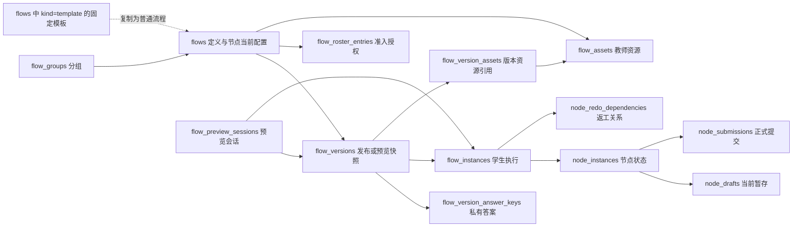

# 数据库表冗余、复用与精简审计

更新日期：2026-10-15（重新核对当前源码与本地数据库）。

**当前结构：本地数据库共 48 张非 SQLite 内部表；本文说明其中 13 张 Flow、Node 类表，分别为 9 张和 4 张。** 当前表清单与源码建表定义一致，流程模板复用 `flows`，没有独立的 `workflow_*` 表。

本文仅记录这些表的当前职责、约束、关联及本地行数，不扩展为全库逐表审计。其余 35 张表仅在说明依赖关系时引用。行数为本次迁移完成时的快照，包含归档、停用和预览相关记录，不代表当前活跃业务量。

依据根目录 [MEMORY.md](../MEMORY.md) 的事实来源顺序，以当前源码与实际数据库为准。核对范围包括 `backend/app/core/database.py`、相关仓储及本地 `backend/storage/app.db`；模板迁移前已备份，事务中核对原有字段和其他业务记录，外键与完整性检查通过。验证范围为业务逻辑审计、Python 语法、TypeScript 类型检查和本地服务启动；未运行测试、构建、HTTP 或浏览器验证。

## 1. 当前各表的职责和作用

### 1.1 Flow 类：9 张

| 表名 | 本地行数 | 一条记录表示什么 | 职责与主要读写场景 |
| --- | ---: | --- | --- |
| `flow_groups` | 3 | 某教师创建的流程分组 | 主键 `id`，同一教师下组名唯一；支持空组、改名与流程归组。`flows.group_id` 引用；包括归档流程在内，只要仍有流程引用便不能删除分组 |
| `flows` | 30 | 一个流程定义 | 主键 `id`；保存名称、归属、配置 JSON、分组和生命周期；`kind` 区分普通流程与固定模板，`is_shared` 表示模板上架状态；当前节点参数直接保存在 `draft_config.nodes`；节点 `_configMeta` 仅记录普通参数、单脚本审核和多步骤审核各自的修改代次、修改人和时间，不重复保存参数值 |
| `flow_versions` | 33 | 某流程的一次发布或预览 | 按 `(flow_id, version_no)` 唯一；保存配置快照及 hash，关联实例、私有答案和资源引用。当前正式发布 13 条、停用 19 条、预览 1 条；正式运行以版本确定节点/连线和固定结构，再读取当前节点允许实时修改的字段；预览只读自己的快照 |
| `flow_instances` | 233 | 一个学生在一个版本中的执行实例 | 按 `(flow_version_id, student_account_id)` 唯一；正式学生进入时按需创建，预览也创建实例。保存整体状态及活动时间，不作为名单授权依据 |
| `flow_roster_entries` | 375 | 某流程对一个学号的准入授权 | 按 `(flow_id, student_no)` 唯一；保存姓名、学号及有效/撤销状态。正式访问持续校验名单，不要求学生已创建实例；有效预览会话走专用授权路径 |
| `flow_preview_sessions` | 1 | 某教师的一次学生视角预览会话 | 教师、版本、实例各有唯一约束；关联预览学生及令牌 hash，保存有效期和 active/cleaning 状态，负责预览授权及临时数据清理 |
| `flow_version_answer_keys` | 20 | 某版本某答题卡的私有标准答案 | 主键 `(flow_version_id, node_key)`；冻结私有答案及 hash。正式评分优先使用后续答案修订，无修订时回退本表；预览使用冻结答案，历史判分按使用过的 hash 解析 |
| `flow_assets` | 154 | 教师上传的一份节点资源 | 主键 `id`，`storage_key` 唯一；`asset_kind` 区分 template/content/announcement，分别为 145/8/1 条。保存流程、节点、创建人及 OSS 元数据，不保存学生提交文件 |
| `flow_version_assets` | 115 | 某版本某节点对一份资源的冻结引用 | 按版本、节点、类别、资源去重；主模板/图片/附件分别为 95/14/6 条。类别组合外键保护资源引用，部分唯一索引限制每版本每节点一个主模板；不是全部 JSON 引用的索引 |

当前存储有三处需要区分：

- **生效配置**：普通参数、单脚本 `auditScriptParams`、多步骤 `fileReviewSteps[].auditScriptParams` 及模型引用均直接维护在节点内。后端白名单决定允许修改和读取的字段，保存后立即生效；已发布节点的普通草稿保存保留服务端最新生效参数，避免旧页面覆盖。分支节点仍沿用原来的修订发布路径。正式学生个别延期继续由 `student_deadline_overrides` 优先处理；预览沿用既有时间处理。
- **资源与引用**：`flow_assets` 保存资源实体，`flow_version_assets` 保存版本引用；参考材料及当前节点中的引用仍需检查 JSON。`asset_kind='template'` 表示节点主模板或参考文件，不等于流程模板库中的模板条目。正文图片限制 5 MiB，公告附件限制 50 MiB，二者保留格式 CHECK。
- **私有答案**：`answer_sheet_drafts` 保存编辑内容，`flow_version_answer_keys` 保存发布依据，`answer_sheet_key_revisions` 保存后续修订；这些职责不能因字段相似而混用。

依据：[database.py](../backend/app/core/database.py)、[workflows.py](../backend/app/repositories/workflows.py)、[flow_assets.py](../backend/app/repositories/flow_assets.py)、[flow_roster.py](../backend/app/repositories/flow_roster.py)、[flow_previews.py](../backend/app/repositories/flow_previews.py)、[answer_sheet_keys.py](../backend/app/repositories/answer_sheet_keys.py)、[flow_runtime_state.py](../backend/app/repositories/flow_runtime_state.py)、[published_node_parameters.py](../backend/app/repositories/published_node_parameters.py)。

### 1.2 Node 类：4 张

| 表名 | 本地行数 | 一条记录表示什么 | 职责与主要读写场景 |
| --- | ---: | --- | --- |
| `node_instances` | 1,092 | 一个学生流程实例中的一个节点 | 按 `(flow_instance_id, node_key)` 唯一；保存状态、开放/提交/通过时间、尝试次数与重置基线、或节点胜出前驱。关联草稿、提交和审核；节点定义仍在配置 JSON 中 |
| `node_drafts` | 10 | 一个节点实例尚未正式提交的输入 | 以 `node_instance_id` 为主键，一实例至多一份；暂存覆盖，成功提交后删除，撤销通过时可恢复。它不是提交历史；已通过节点也可能存在新草稿 |
| `node_redo_dependencies` | 35 | 某学生实例中一次返工产生的等待关系 | 主键为实例、源节点、目标节点；教师撤销通过时记录，路径判断时阻塞目标，源节点重新通过后清理 |
| `node_submissions` | 500 | 某学生节点实例的一次正式提交 | 原表名 `submissions`，仅重命名；字段和记录内容保持不变。保存 `payload_snapshot`、提交次数编号、幂等标识、状态和提交时间；按 `(node_instance_id, attempt_no)` 及 `(node_instance_id, idempotency_key)` 唯一 |

`node_audit_policies` 和 `node_review_step_policies` 已迁移并删除：原单脚本策略迁入对应节点，原多步骤参数覆盖合并到对应审核步骤。两类接口保留，但底层共用节点配置，不再单独存储；审核任务保留实际执行参数快照及历史记录。`publishedNodeParameters` 已移除。

依据：[flow_instances.py](../backend/app/repositories/flow_instances.py)、[manual_review_state.py](../backend/app/repositories/manual_review_state.py)、[node_progress.py](../backend/app/repositories/node_progress.py)、[branch_state.py](../backend/app/repositories/branch_state.py)、[audit_policies.py](../backend/app/repositories/audit_policies.py)、[review_step_policies.py](../backend/app/repositories/review_step_policies.py)、[node_models.py](../backend/app/services/node_models.py)。

### 1.3 流程模板：复用现有 Flow 表

| 存储位置 | 当前含义 | 约束 |
| --- | --- | --- |
| `flows.kind` | `normal` 为普通流程，`template` 为固定流程模板，默认 `normal` | 当前普通流程 24 条、归档模板 6 条；普通列表与编辑入口只接受普通流程 |
| `flows.is_shared` | 模板是否上架，默认 0 | 仅模板可以为 1；模板库排除归档记录，普通教师仅看到上架模板 |
| `flows` 既有字段 | 名称、简介、创建者、固定节点配置及归档状态 | 新模板 `owner_id` 保存创建者；现存 6 条归档旧定义仍保留原模板命名空间归属，不猜测创建者 |
| `flow_assets`、`answer_sheet_drafts` | 模板独立的文件资源及私有标准答案 | 与普通流程共用表，通过 `flow_id` 归属；发布模板及使用模板均复制资源，模板内容发布后不可编辑 |

当前模板管理限超级管理员。发布模板从本人流程创建独立模板记录，清空起止时间与私人模型引用，不复制名单和学生记录，也不创建学生用的 `flow_versions`。普通教师使用上架模板，得到本人可编辑的普通流程草稿。

`/api/workflow-templates` 提供发布、列表、上下架、复制使用及归档接口；不提供原地更新或模板编辑草稿接口。修改模板需先复制为普通流程，编辑后发布新模板。模板归档保留其定义与资源，不影响已创建的独立副本。普通流程保存、资源修改、参数修改和数据库行编辑均不能修改固定模板。

流程模板内容保存在自己的 `flows.draft_config` 中；`flow_versions` 继续服务于普通流程的学生发布和预览，不承担模板库的版本管理。

依据：[workflow_blueprints.py](../backend/app/repositories/workflow_blueprints.py)、[模板路由](../backend/app/api/routes/workflow_blueprints.py)、[workflows.py](../backend/app/repositories/workflows.py)、[模板迁移](../backend/app/core/flow_template_migration.py)、[前端请求定义](../frontend/src/features/academic-flow/api.ts)、[user_deletion.py](../backend/app/repositories/user_deletion.py)。

### 1.4 当前核心关系

箭头表示业务关联，不表示外键方向或全部基数；图中 `node_submissions` 计入本次 13 张目标表；模板框表示 flows 中的一类记录，不是新表。流程定义、学生状态、暂存和正式提交具有不同生命周期，不能仅因部分字段类似就合并。

### 1.5 本次节点配置整改结果

- 整改前检查点：`7e974a4`。SQLite 完整备份：`backend/storage/backups/node-config-consolidation-20261015-141243.db`，备份完整性检查为 `ok`。回退必须配对恢复该代码检查点与数据库备份。
- 迁移 ID：`20261015_node_configuration`。事务内核对 513 个普通参数值、2 条单脚本策略和 7 条多步骤策略，保持参数、模型引用及修改代次；其余 48 张表数据摘要未变，包含全部 33 条版本记录、1,092 条节点状态、495 条提交。迁移仅额外写入配置迁移审计和迁移标记。
- 当前库没有历史 `versionOverrides`。升级迁移仍支持其物化到对应版本，记录原始配置及修改证据；当前库未走该兼容分支，全部发布/预览快照保持原样。
- 单脚本任务的正常执行和服务恢复共用同一配置有效性规则；正式任务领取时读取当前参数，已开始执行的任务保留执行快照。预览审核从预览版本取参；多步骤审核也统一经过运行配置入口。
- 模型引用检查、资源引用检查、账号清理、复制、模板下载开放时间、教师进度及导出均已调整。前端普通字段过滤读取后端白名单；学生响应剔除审核参数、模型引用及服务端元信息。
- 两张旧策略表不再建表，运行代码不再查询；旧名称只用于历史升级迁移。当前共 51 张非 SQLite 内部表，目标前缀表共 15 张，外键检查无违例。
- 本地重启：`bash deploy/run_dev.sh`；后端 `127.0.0.1:9000` 启动完成，前端 `6173` 就绪，未使用 Docker。
- 验证边界：Python 语法和本地导入符号静态检查、Git diff 检查及数据库迁移核对已完成；未运行测试、构建或浏览器，不能视为完整业务回归。历史测试中的截止时间写入方式已同步新存储，但未执行测试。
