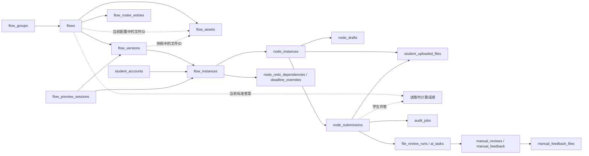

# 数据库表现状说明

核对时间：2026-10-15 22:30:58（Asia/Shanghai）。

**当前本地数据库共有 41 张非 SQLite 内部表，本文逐表覆盖全部 41 张。** 按业务职责分为 7 组；按名称前缀统计，Flow 类 7 张、Node 类 6 张，其余 28 张，没有独立的 `workflow_*` 表。业务分组与名称前缀是两种统计口径，不能相加。

本文以当前源码和 `backend/storage/app.db` 为准。结构、约束及索引以 SQLite 实际定义为准，覆盖基础建表和初始化增量迁移。标准答案保存在流程节点配置中，成绩在读取时计算，不设答题卡专用表。

行数均为上述时点的快照，包含归档、停用、过期及历史记录，不代表活跃业务量。0 行表示当时无记录；是否仍有业务用途，需要结合读写代码判断。本次已同步数据库结构、后端清理逻辑与文档；未运行测试或浏览器验证。

## 1. 全表概览

| 业务分组 | 表数 | 保存的主要内容 |
| --- | ---: | --- |
| 账号、登录与注册 | 8 | 身份、会话、注册准入及密码找回 |
| 流程定义、分组与准入 | 4 | 流程/模板定义、版本、分组及名单 |
| 学生运行、输入与进度 | 7 | 流程实例、节点状态、暂存、提交、返工与个别延期 |
| 文件资源与下载 | 4 | 教师资源、版本引用、学生文件、下载与个人文件 |
| 审核任务、人工处理与反馈 | 11 | 自动审核、步骤进度、人工结论和反馈材料 |
| 审核脚本运行与模型配置 | 3 | 脚本状态、模型连接卡及兼容绑定结构 |
| 系统审计与后台任务 | 4 | 操作记录、迁移标记、导出及删除清理任务 |
| **合计** | **41** | 每张表只归入一个业务分组 |

相关代码：[database.py](../backend/app/core/database.py)、[sms_recovery.py](../backend/app/services/sms_recovery.py)、[model_ownership.py](../backend/app/services/model_ownership.py)、[flow_template_migration.py](../backend/app/core/flow_template_migration.py)。

## 2. 当前各表的职责与关联

### 2.1 账号、登录与注册：8 张

| 表名 | 行数 | 一条记录表示什么 | 保存什么、什么时候用 |
| --- | ---: | --- | --- |
| `teacher_accounts` | 4 | 一个教师或超级管理员账号 | 保存教师的工号、姓名、密码校验值、手机号和身份。登录时查这张表，区分普通教师和超级管理员；同一工号不能注册两个账号。 |
| `student_accounts` | 127 | 一个正式或预览学生账号 | 保存学生的学号、姓名、密码校验值和手机号。正式学生和教师预览时使用的模拟学生都在这里；模拟学生另记所属教师，同一学号不能重复注册。 |
| `teacher_sessions` | 16 | 一次教师登录会话 | 教师登录后，记录“哪个账号已登录、登录凭证何时过期”。后续请求用它识别教师，退出登录时删除对应记录；一个教师可以有多次登录记录。 |
| `student_sessions` | 398 | 一次学生登录会话 | 学生登录后，记录账号、登录凭证的校验值和有效期。后续请求用它识别学生；旧记录也可能留在表中，因此行数不是当前在线学生数。 |
| `teacher_invitations` | 7 | 一次教师注册邀请 | 保存管理员邀请哪位教师注册、邀请何时到期、是否已使用或撤销。邀请被使用后，记下注册成功的教师账号；同一工号不能同时有两份有效邀请。 |
| `registration_allowlist` | 373 | 一条学生注册准入信息 | 保存允许注册的学生姓名、学号和班级，也允许先导入不完整信息再补齐。它决定“能否注册账号”；注册后能进入哪些流程，要另外看流程名单。 |
| `sms_challenges` | 2 | 一次短信验证请求 | 发送短信验证码时，记录发给谁、用于绑定手机号还是改密/找回、何时过期、验证了几次。具体验证码交给短信服务核验，这里不保存验证码明文。 |
| `password_recoveries` | 2 | 一次密码找回流程 | 学生或教师找回密码时，记录找回的是哪个账号、是否已验证手机号、是否还允许设置新密码。通过状态和有效期阻止已过期或已用过的凭证再次改密。 |

相关代码：[auth.py](../backend/app/api/routes/auth.py)、[flow_previews.py](../backend/app/repositories/flow_previews.py)、[security.py](../backend/app/services/security.py)、[teacher_invitations.py](../backend/app/repositories/teacher_invitations.py)、[registration_allowlist.py](../backend/app/repositories/registration_allowlist.py)、[sms_recovery.py](../backend/app/services/sms_recovery.py)。

### 2.2 流程定义、分组与准入：4 张

| 表名 | 行数 | 一条记录表示什么 | 保存什么、什么时候用 |
| --- | ---: | --- | --- |
| `flow_groups` | 3 | 某教师创建的一个流程分组 | 保存教师创建的流程文件夹，例如“毕业论文”“课程作业”。每个流程记下自己属于哪个分组；同一教师不能建两个同名组，组里仍有流程时不能删除该组。 |
| `flows` | 31 | 一个普通流程或固定流程模板 | 保存“毕业论文流程”这样的流程名称、所属教师，以及全部节点、连线和当前配置。答题卡的题目和私有标准答案也在节点配置中。普通流程和固定模板用类型字段区分；模板另有是否上架的标志。 |
| `flow_versions` | 33 | 普通流程的一次发布或预览版本 | 发布或预览时，保存当时的节点、连线和配置副本，并记录版本号。学生进度绑定某个版本；运行时用当前配置覆盖允许实时修改的部分，例如标题和截止时间；正式判分读取当前答案，预览答案保存在自己的快照中。 |
| `flow_roster_entries` | 375 | 某流程对某学号的一条准入记录 | 保存“哪些学生能进入这个流程”。例如老师给毕业论文流程导入姓名和学号，系统每次访问都检查这份名单；撤销资格后，已有进度也不能继续访问。 |

相关代码：[workflow_groups.py](../backend/app/repositories/workflow_groups.py)、[workflows.py](../backend/app/repositories/workflows.py)、[workflow_blueprints.py](../backend/app/repositories/workflow_blueprints.py)、[flow_runtime_state.py](../backend/app/repositories/flow_runtime_state.py)、[flow_roster.py](../backend/app/repositories/flow_roster.py)、[database.py](../backend/app/core/database.py)、[user_deletion.py](../backend/app/repositories/user_deletion.py)。

### 2.3 学生运行、输入与进度：7 张

| 表名 | 行数 | 一条记录表示什么 | 保存什么、什么时候用 |
| --- | ---: | --- | --- |
| `flow_instances` | 233 | 一个学生在一个版本下的执行实例 | 保存某个学生在某个流程版本中的整体进度，例如“张三的毕业论文尚未完成”。学生首次进入时创建，再次进入复用；同一学生在同一版本下只有一份。 |
| `flow_preview_sessions` | 1 | 某教师的一次学生视角预览会话 | 老师点击学生视角预览时，记录这次预览用了哪个模拟学生、哪个版本、哪份进度以及何时过期。系统据此允许预览访问，并定位需要清理的临时数据。 |
| `node_instances` | 1,073 | 一个学生流程实例中的一个节点状态 | 保存“张三的开题报告节点是否开放、提交过几次、是否通过”等状态，并记下相关时间。一个学生的一份流程进度中，每个节点只有一条状态记录。 |
| `node_drafts` | 10 | 一个节点实例当前暂存的学生输入 | 保存学生点击暂存后、尚未正式提交的内容。再次暂存会覆盖这份内容，成功提交后删除；部分撤销通过的操作会把上次提交恢复到这里，供学生修改。 |
| `node_submissions` | 501 | 某学生节点实例的一次正式提交 | 保存学生每次正式提交的内容、提交时间和第几次尝试。审核任务指向具体这次提交；答题卡成绩用当前这次提交的答案实时计算；同一次提交请求重复发送时，不应再生成第二条记录。 |
| `node_redo_dependencies` | 35 | 一个学生流程实例中一条返工等待关系 | 例如开题报告被撤销通过后，记录“张三的论文初稿必须等开题报告重新通过”。系统据此阻止他直接继续下游节点；每条记录只针对该学生的这份流程进度。 |
| `node_deadline_overrides` | 2 | 某学生流程实例中某节点的个别截止时间 | 保存单个学生的特殊截止时间。例如全班 6 月 1 日截止，张三获准延至 6 月 5 日，这里记录张三、对应节点、新日期、原因和操作教师；其他学生仍用统一日期。 |

相关代码：[flow_instances.py](../backend/app/repositories/flow_instances.py)、[flow_previews.py](../backend/app/repositories/flow_previews.py)、[node_progress.py](../backend/app/repositories/node_progress.py)、[branch_state.py](../backend/app/repositories/branch_state.py)、[flow_runtime_state.py](../backend/app/repositories/flow_runtime_state.py)。

### 2.4 文件资源与下载：4 张

| 表名 | 行数 | 一条记录表示什么 | 保存什么、什么时候用 |
| --- | ---: | --- | --- |
| `flow_assets` | 167 | 教师为某流程节点保存的一份资源 | 保存老师上传的填写模板、参考示例、正文图片和公告附件的文件名、大小、存储位置及所属节点。文件本身放在 OSS；节点当前配置和发布、预览快照直接通过文件 ID 引用这里。上传但未被采用的文件可以留在此表；学生提交的文件另存。 |
| `student_uploaded_files` | 401 | 学生上传的一份原始文件或扫描材料 | 保存学生上传的论文、表格或扫描件的文件信息，包括属于谁、哪个节点、存储位置、页数和顺序。刚上传时可以尚未提交，正式提交后再记下对应的提交记录。 |
| `node_template_download_events` | 44 | 某节点实例对某份主模板的下载记录 | 记录某学生在某节点下载了哪份主模板及下载时间，供系统检查下载情况。同一节点实例和同一模板只保留一条记录，不是每下载一次就新增一行。 |
| `teacher_drive_files` | 0 | 教师个人文件区的一份文件 | 保存教师个人文件区中的文件名、大小、存储位置及所属教师。这些文件单独管理，不会仅因上传到个人文件区就自动成为某个流程的模板或学生作业。 |

相关代码：[flow_assets.py](../backend/app/repositories/flow_assets.py)、[flow_templates.py](../backend/app/repositories/flow_templates.py)、[flow_content_assets.py](../backend/app/repositories/flow_content_assets.py)、[flow_announcement_files.py](../backend/app/repositories/flow_announcement_files.py)、[flow_files.py](../backend/app/repositories/flow_files.py)、[routes/personal_drive.py](../backend/app/api/routes/personal_drive.py)、[repositories/personal_drive.py](../backend/app/repositories/personal_drive.py)。

### 2.5 审核任务、人工处理与反馈：11 张

| 表名 | 行数 | 一条记录表示什么 | 保存什么、什么时候用 |
| --- | ---: | --- | --- |
| `audit_jobs` | 0 | 一次正式提交对应的单脚本审核任务 | 学生提交后，如果走单脚本自动审核，就记录一项待处理任务。保存审核哪次提交、用哪个脚本和哪些参数、是否执行完、失败后是否重试，以及最终结果。 |
| `file_review_runs` | 212 | 一次提交的多步骤审核执行进度 | 某次提交需要按顺序完成多个审核步骤时，记录步骤列表、当前走到哪一步，以及是否完成或被退回。例如 AI 检查通过后，继续等待教师审核。 |
| `file_review_ai_tasks` | 208 | 一次提交中某个 AI 审核步骤的任务 | 为某次提交的每个 AI 审核步骤分别保存任务、执行参数和结果。例如第一步检查格式、第二步检查内容，会有两项任务；执行到对应步骤时读取允许更新的当前参数。 |
| `manual_reviews` | 183 | 教师对一组材料作出的一次正式审核 | 老师正式作出审核决定时，保存审核了哪个学生的哪个节点、当时看到哪些材料、结论和评语。材料内容依据也会保存，便于分清老师审核的是哪次提交。 |
| `manual_feedback_drafts` | 199 | 某节点实例当前暂存的教师反馈文件选择 | 保存老师正在编辑、尚未发布的反馈文件选择。每个节点实例保留一份；记录它针对哪份学生材料，并检查修改次数，避免旧页面覆盖较新的编辑。 |
| `manual_feedback_files` | 0 | 教师上传的一份批改反馈文件 | 保存老师上传的批改稿或反馈附件，记录它针对哪份学生原件、文件名和 OSS 存储位置。学生原件仍在 `student_uploaded_files`，不会被批改文件直接覆盖。 |
| `manual_feedback` | 180 | 一份正式发布的教师反馈 | 老师发布反馈时，保存评语、选中的批改文件、对应材料和发布时间。学生读取的是已发布且允许查看的反馈，不是老师仍在编辑的暂存内容。 |
| `file_review_feedback_context` | 180 | 一份正式反馈对应的审核提交与步骤 | 给一份已发布反馈标明“属于哪次学生提交、哪个审核步骤”。例如同一份论文经过两轮提交，系统据此区分老师这条意见针对的是哪一轮。 |
| `manual_source_reviews` | 0 | 一条按材料来源节点记录的人工审核记录 | 用于保存老师对某份材料来源节点的审核意见，例如注明审核的是哪个上游节点的材料。当前表为空，只保留旧记录读取、版本迁移和账号删除时的处理代码，没有常规新增入口。 |
| `manual_node_rejections` | 0 | 一条针对学生节点某次尝试的人工退回记录 | 用于记录某学生某次提交被老师退回，包括退回原因、相关反馈和操作教师。当前表为空，仍有读取旧退回信息及迁移、清理代码，没有常规新增入口。 |
| `teacher_review_remarks` | 11 | 某教师的一条常用审核评语 | 保存老师可重复选用的评语，例如“材料齐全，符合要求”。删除评语时会把文字清空，保留位置以防默认评语再次出现，所以表中行数可能多于界面显示的条数。 |

相关代码：[audit_jobs.py](../backend/app/repositories/audit_jobs.py)、[audit_job_worker.py](../backend/app/services/audit_job_worker.py)、[file_reviews.py](../backend/app/repositories/file_reviews.py)、[file_review_tasks.py](../backend/app/repositories/file_review_tasks.py)、[manual_reviews.py](../backend/app/repositories/manual_reviews.py)、[manual_feedback.py](../backend/app/repositories/manual_feedback.py)、[workflows.py](../backend/app/repositories/workflows.py)、[manual_review_state.py](../backend/app/repositories/manual_review_state.py)、[user_deletion.py](../backend/app/repositories/user_deletion.py)、[review_remarks.py](../backend/app/repositories/review_remarks.py)。

### 2.6 审核脚本运行与模型配置：3 张

| 表名 | 行数 | 一条记录表示什么 | 保存什么、什么时候用 |
| --- | ---: | --- | --- |
| `audit_script_runtime_states` | 8 | 一个审核脚本的当前运行状态 | 记录每个审核脚本当前能否执行、是否正在更新、代码和配置是否变化，以及最多同时运行几个任务。完整脚本放在仓库文件中，这张表只保存运行管理信息。 |
| `audit_model_cards` | 7 | 某教师的一张模型连接卡 | 保存老师配置的大模型接口地址、模型名称、加密密钥及相关选项。节点只记下选用了哪张模型卡；实际调用模型时再读取这张卡，不在每个节点重复保存密钥。 |
| `audit_model_bindings` | 0 | 一条旧的教师—脚本—模型卡绑定 | 旧方式用它记录“某老师的某个审核脚本使用哪张模型卡”。现在直接在节点配置中记录选用的模型卡；本表当前为空，仅保留旧数据库升级和账号清理代码。 |

相关代码：[audit_script_runtime.py](../backend/app/services/audit_script_runtime.py)、[audit_script_catalog.py](../backend/app/services/audit_script_catalog.py)、[audit_model_connections.py](../backend/app/services/audit_model_connections.py)、[node_models.py](../backend/app/services/node_models.py)、[model_ownership.py](../backend/app/services/model_ownership.py)、[user_deletion.py](../backend/app/repositories/user_deletion.py)。

### 2.7 系统审计与后台任务：4 张

| 表名 | 行数 | 一条记录表示什么 | 保存什么、什么时候用 |
| --- | ---: | --- | --- |
| `audit_logs` | 2,042 | 一次业务操作或执行依据记录 | 记录谁在什么时候做了什么，例如修改流程、撤销某学生的通过状态；按操作保存修改前后内容和原因。审核实际采用的参数也可记在这里，用来追查处理依据。 |
| `schema_migrations` | 22 | 一项已执行的数据库迁移标记 | 记录哪些数据库升级已经完成，以及完成时间。服务下次启动时先查这张表，避免把同一次升级重复执行；它不保存老师或学生的业务内容。 |
| `material_export_jobs` | 5 | 教师对某发布版本发起的一次材料导出任务 | 老师点击导出材料后，记录导出哪个流程版本、是否排队或完成、结果文件名及何时过期。相同教师对同一版本已有任务在排队或执行时，复用该任务，避免重复打包。 |
| `user_deletion_jobs` | 11 | 账号删除后的一个 OSS 文件清理任务 | 删除账号后，记录还需要从 OSS 删除哪些文件。后台按清单逐个清理，并更新剩余文件和失败原因；这样数据库记录已删除后，外部文件仍有明确的清理清单。 |

相关代码：[workflows.py](../backend/app/repositories/workflows.py)、[node_progress.py](../backend/app/repositories/node_progress.py)、[audit_jobs.py](../backend/app/repositories/audit_jobs.py)、[database_admin.py](../backend/app/repositories/database_admin.py)、[database.py](../backend/app/core/database.py)、[answer_sheet_migration.py](../backend/app/core/answer_sheet_migration.py)、[flow_asset_reference_migration.py](../backend/app/core/flow_asset_reference_migration.py)、[flow_consolidation.py](../backend/app/core/flow_consolidation.py)、[node_configuration_migration.py](../backend/app/core/node_configuration_migration.py)、[flow_template_migration.py](../backend/app/core/flow_template_migration.py)、[export_jobs.py](../backend/app/repositories/export_jobs.py)、[export_job_worker.py](../backend/app/services/export_job_worker.py)、[user_deletion.py](../backend/app/repositories/user_deletion.py)、[user_deletion_worker.py](../backend/app/services/user_deletion_worker.py)。

## 3. 当前配置、模板与学生数据如何连接

### 3.1 流程配置和发布快照

`flows.draft_config` 是流程定义 JSON，核心结构为 `nodes` 和 `edges`。节点内保存类型、标题、表单或题目结构、资源引用、审核脚本标识及参数、多步骤审核配置等；`_configMeta` 保存参数修改代次、修改人和时间，不另存一份参数值。当前没有独立的节点定义表、节点普通参数表或节点审核策略表。

正式学生运行时，后端先读取 `flow_versions.config_snapshot`，以版本确定节点、连线和固定结构，再按稳定节点 ID，从同一流程的 `draft_config` 叠加白名单允许的当前字段。可变字段包括适用节点的标题、说明、时间、参考文件，以及符合脚本/步骤结构校验的审核参数和模型卡引用。新增节点不会因修改草稿直接出现在旧版本中，需要发布；条件分支的普通字段仍走修订发布路径。

**当前快照仍保存节点配置，并未精简成只含拓扑的 JSON，也不是数据库字段直接指向另一个 JSON 字段。** “使用最新参数”由后端读取与合并逻辑实现。预览不叠加正式流程当前参数，读取自己的快照；正式学生的个别截止时间还会优先读取 `node_deadline_overrides`。

本次快照中，`flow_versions` 共 33 条：published 13 条、disabled 19 条，preview 1 条；`flow_preview_sessions` 当前为 1 条。

### 3.2 固定流程模板

| 字段或存储位置 | 当前规则 |
| --- | --- |
| `flows.kind` | 默认 normal；template 表示固定流程模板 |
| `flows.is_shared` | 默认 0；仅 template 可以设为 1，表示上架 |
| `flows.status` | 与类型分开；模板归档后不出现在模板列表，上下架通过 `is_shared` 控制 |
| `flows.owner_id` | 新模板保存创建者；旧归档定义可能仍保留原模板命名空间归属 |
| `flows.draft_config` | 模板自己的固定内容；模板发布后不能原地编辑 |
| `flow_assets` | 按模板自身 `flow_id` 保存独立附件 |
| `flows.draft_config.nodes[].answerSheetKey` | 模板自己的私有标准答案，复制模板时一并复制 |

相关代码：[routes/workflow_blueprints.py](../backend/app/api/routes/workflow_blueprints.py)、[repositories/workflow_blueprints.py](../backend/app/repositories/workflow_blueprints.py)、[workflows.py](../backend/app/repositories/workflows.py)。

当前共有 31 条流程定义：24 条普通流程（draft 7、published 13、archived 4），7 条模板（均为 archived、未上架）。当前无可见模板不等于模板功能已移除。

超级管理员从本人普通流程发布模板时，创建独立定义和资源副本，清空起止时间与私人模型引用，不复制学生名单、实例和提交。使用上架模板会创建教师自己的普通草稿，后续修改互不影响。固定模板只支持上下架或归档；修改内容需要复制、编辑后发布新模板。

模板发布不创建学生运行版本，`flow_versions` 不承担模板库版本链的职责。当前源码中的 `workflow_blueprints.py` 等模块名和 `/api/workflow-templates` 接口名仍保留，但不代表数据库中存在同名表。

### 3.3 学生状态、暂存和提交

| 数据层 | 表 | 回答的问题 |
| --- | --- | --- |
| 准入资格 | `flow_roster_entries` | 这个学生是否有权进入该流程？ |
| 流程进度 | `flow_instances` | 这个学生在该版本下进行到什么状态？ |
| 节点进度 | `node_instances` | 这个节点是否开放、已提交、通过或需要返工？ |
| 尚未提交的输入 | `node_drafts` | 学生现在暂存了什么？ |
| 正式输入 | `node_submissions` | 这次正式提交了什么、属于第几次尝试？ |
| 输入中的文件 | `student_uploaded_files` | 对应的原始文件存放在哪里、是否已关联提交？ |
| 处理过程与输出 | 审核任务、人工审核和反馈表 | 谁处理了这次提交，留下什么结论和反馈？ |
| 答题卡成绩 | 不落表 | 用该次学生作答与当前标准答案计算分数和逐题对错 |

相关代码：[flow_roster.py](../backend/app/repositories/flow_roster.py)、[flow_instances.py](../backend/app/repositories/flow_instances.py)、[flow_files.py](../backend/app/repositories/flow_files.py)、[audit_jobs.py](../backend/app/repositories/audit_jobs.py)、[file_reviews.py](../backend/app/repositories/file_reviews.py)、[answer_sheet_grades.py](../backend/app/repositories/answer_sheet_grades.py)。

这些数据通过流程版本、实例、节点实例和提交 ID 关联。节点配置中的稳定 ID 与学生节点状态表的 `node_key` 对应；节点标题不是关联键。暂存内容、正式提交和当前状态具有不同生命周期。

### 3.4 教师资源、参考示例与学生文件

`flow_assets.asset_kind='template'` 包括节点的主模板和参考材料，不表示“流程模板库中的一条模板”。`content` 用于正文或题目图片，`announcement` 用于公告附件。当前三类资源分别为 157、9、1 条。

资源引用直接保存在节点 JSON：`templateAsset.assetId` 指定主模板，`referenceAssets[].assetId` 指定参考示例，题目图片及公告附件通过正文中的 `asset://文件ID` 引用。正式运行时，主模板等固定项沿用发布快照，允许修改的参考材料等取当前配置；预览使用自己的快照。教师提供的文件、学生上传的原件、教师反馈文件分别由 `flow_assets`、`student_uploaded_files`、`manual_feedback_files` 管理；数据库保存元数据，文件内容在 OSS。

删除资源前，后端在同一事务中检查所有流程当前配置、所有保留的版本快照及模板下载记录；仍被引用的文件不能删除。下载时同时检查学生身份、流程准入、有效节点配置中的引用和文件归属。配置中的引用由后端校验，JSON 本身没有数据库外键约束。

相关代码：[node_assets.py](../backend/app/domain/node_assets.py)、[flow_assets.py](../backend/app/repositories/flow_assets.py)、[flow_templates.py](../backend/app/repositories/flow_templates.py)、[flow_content_assets.py](../backend/app/repositories/flow_content_assets.py)、[flow_announcement_files.py](../backend/app/repositories/flow_announcement_files.py)。

### 3.5 标准答案、成绩和审核执行依据

答题卡复用已有表，不单独保存成绩：

| 内容 | 保存位置或计算方式 |
| --- | --- |
| 题目、选项、分值与反馈规则 | `flows.draft_config.nodes[].answerSheet`；发布后使用版本固定的题目结构 |
| 当前标准答案 | 同一节点的 `answerSheetKey`；`_configMeta.answerKey` 只记录修改次数、修改人和时间，用于避免旧页面覆盖新答案 |
| 学生暂存与正式作答 | 暂存写入 `node_drafts.payload`，正式提交写入 `node_submissions.payload_snapshot` |
| 当前成绩 | 后端读取当前提交和最新标准答案，计算总分、各题得分及对错；不保存成绩或成绩历史 |
| 预览答案 | `flow_versions.config_snapshot.nodes[].answerSheetKey`，保持创建预览时的答案 |

学生进入流程、点击“查看节点分数”，以及教师查看、导出时，后端实时计算成绩。老师改答案后，下次读取就使用新答案；已下载的导出文件不会自行变化。查看分数不增加提交次数，也不修改已通过状态或下游进度。

正式发布快照不保存标准答案。教师接口仍通过 `answerSheetKeys` 映射编辑答案，后端保存时将其合入节点；学生接口会剔除 `answerSheetKey` 和 `_configMeta`，结果按反馈规则裁剪。只有配置了截止后公开答案、且该学生的有效截止时间已过时，才返回标准答案。

相关代码：[answer_sheet_keys.py](../backend/app/repositories/answer_sheet_keys.py)、[answer_sheet_policies.py](../backend/app/repositories/answer_sheet_policies.py)、[answer_sheet_grades.py](../backend/app/repositories/answer_sheet_grades.py)、[flow_instances.py](../backend/app/repositories/flow_instances.py)、[teacher_node_exports.py](../backend/app/repositories/teacher_node_exports.py)。

审核配置与审核执行记录同样分开：节点 JSON 保存当前参数，`audit_jobs` 或 `file_review_ai_tasks` 保存执行时采用的参数与结果。相关任务领取时读取适用的当前参数，执行依据还写入 `audit_logs`；不能把已保存的执行快照理解为永远等于教师当前配置。

## 4. 当前保留的兼容结构

下列判断来自当前源码引用与调用链，不仅依据行数；这里只描述现状，不提出删表方案。

| 表 | 当前保留情况 |
| --- | --- |
| `audit_model_bindings` | 0 条；保留初始化迁移和账号清理依赖，当前模型选择直接记录在节点配置中 |
| `manual_source_reviews` | 0 条；保留版本迁移读取与清理依赖，未发现常规新增入口 |
| `manual_node_rejections` | 0 条；保留退回信息读取、版本迁移及清理依赖，未发现常规新增入口 |

相关代码：[workflows.py](../backend/app/repositories/workflows.py)、[node_models.py](../backend/app/services/node_models.py)、[manual_review_state.py](../backend/app/repositories/manual_review_state.py)、[answer_sheet_grades.py](../backend/app/repositories/answer_sheet_grades.py)、[user_deletion.py](../backend/app/repositories/user_deletion.py)。

数据库外键只覆盖显式声明的关系。JSON 中的资源 ID、节点 ID，以及 `flows.owner_id`、部分操作人和通用审计实体标识由应用维护；外键检查通过不能证明所有 JSON 引用或业务权限都有效。

## 5. 核心关系图

图示为核心业务关联，不代表全部外键或精确基数；“读取时计算成绩”是计算过程，不是数据表。`deadline_overrides`、`ai_tasks` 是空间所限的简写，完整表名见第 2 节；固定流程模板属于 `flows` 中的一类记录，不另设模板表。

## 6. 源码核对入口

| 范围 | 主要源码 |
| --- | --- |
| 建表及初始化迁移 | [database.py](../backend/app/core/database.py)、[answer_sheet_migration.py](../backend/app/core/answer_sheet_migration.py)、[flow_asset_reference_migration.py](../backend/app/core/flow_asset_reference_migration.py)、[flow_consolidation.py](../backend/app/core/flow_consolidation.py)、[flow_template_migration.py](../backend/app/core/flow_template_migration.py)、[sms_recovery.py](../backend/app/services/sms_recovery.py)、[model_ownership.py](../backend/app/services/model_ownership.py) |
| 流程、固定模板及运行配置 | [workflows.py](../backend/app/repositories/workflows.py)、[workflow_blueprints.py](../backend/app/repositories/workflow_blueprints.py)、[flow_runtime_state.py](../backend/app/repositories/flow_runtime_state.py)、[node_configuration.py](../backend/app/domain/node_configuration.py) |
| 名单、预览与学生节点 | [flow_roster.py](../backend/app/repositories/flow_roster.py)、[flow_previews.py](../backend/app/repositories/flow_previews.py)、[flow_instances.py](../backend/app/repositories/flow_instances.py)、[branch_state.py](../backend/app/repositories/branch_state.py) |
| 答案与成绩 | [answer_sheet_keys.py](../backend/app/repositories/answer_sheet_keys.py)、[answer_sheet_policies.py](../backend/app/repositories/answer_sheet_policies.py)、[answer_sheet_grades.py](../backend/app/repositories/answer_sheet_grades.py)、[teacher_node_exports.py](../backend/app/repositories/teacher_node_exports.py) |
| 审核与反馈 | [audit_jobs.py](../backend/app/repositories/audit_jobs.py)、[file_reviews.py](../backend/app/repositories/file_reviews.py)、[file_review_tasks.py](../backend/app/repositories/file_review_tasks.py)、[manual_feedback.py](../backend/app/repositories/manual_feedback.py)、[manual_review_state.py](../backend/app/repositories/manual_review_state.py) |
| 模型与脚本 | [audit_model_connections.py](../backend/app/services/audit_model_connections.py)、[node_models.py](../backend/app/services/node_models.py)、[audit_script_runtime.py](../backend/app/services/audit_script_runtime.py) |
| 后台任务及管理 | [export_jobs.py](../backend/app/repositories/export_jobs.py)、[user_deletion.py](../backend/app/repositories/user_deletion.py)、[user_deletion_worker.py](../backend/app/services/user_deletion_worker.py)、[database_admin.py](../backend/app/repositories/database_admin.py) |

相关代码：[router.py](../backend/app/api/router.py)、[main.py](../backend/app/main.py)。
