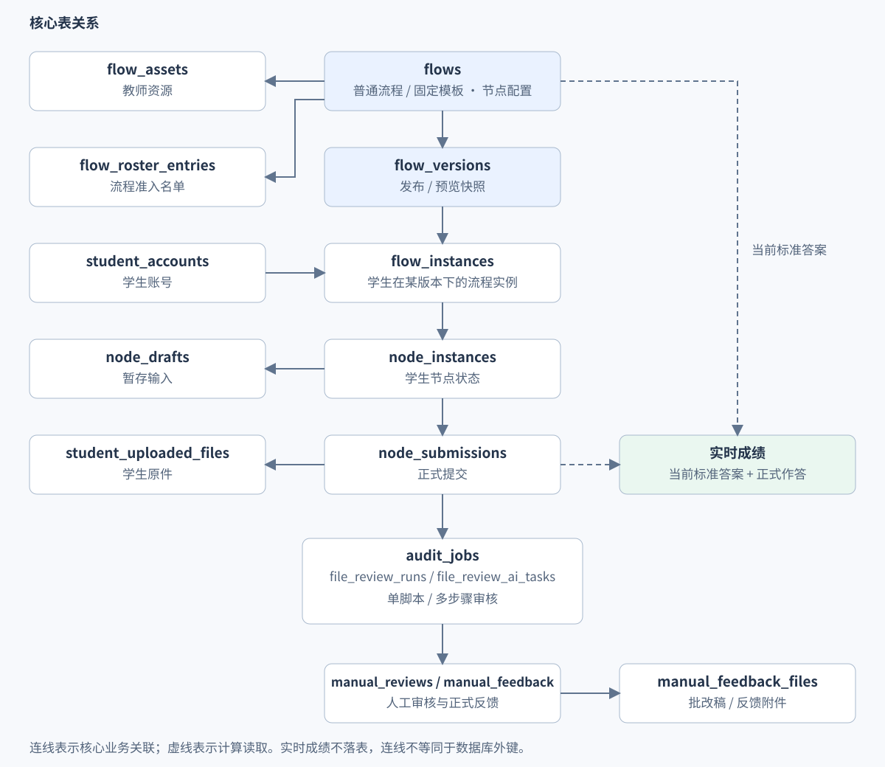
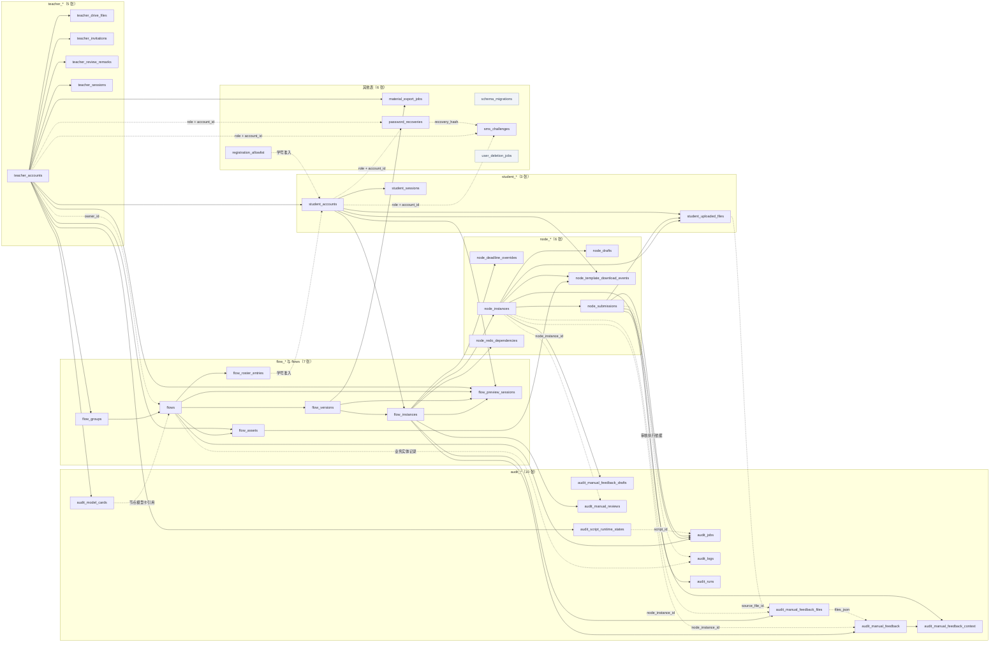

# 数据库表现状说明（按表名前缀）

核对时间：2026-10-16 11:30:37（Asia/Shanghai）。

**当前本地数据库共有 37 张非 SQLite 内部表，本文逐表覆盖全部 37 张。** 按表名前缀保留 5 个多表分组，其余 6 张表统一列入“其他表”，共 6 组，没有独立的 `workflow_*` 表。

本文以当前源码和 `backend/storage/app.db` 为准。结构、约束及索引以 SQLite 实际定义为准，覆盖基础建表和初始化增量迁移。标准答案保存在流程节点配置中，成绩在读取时计算，不设答题卡专用表。

行数均为上述时点的快照，包含归档、停用、过期及历史记录，不代表活跃业务量。0 行表示当时无记录；是否仍有业务用途，需要结合读写代码判断。表清单、行数及图中的外键关联均按上述时点的本地数据库核对。

## 1. 按表名前缀概览

多表分组按前缀字母顺序排列，仅含一张表的前缀统一归入“其他表”；组内按完整表名字母顺序排列。`flows` 是流程主表，与 `flow_*` 合为一组。每张表仅计入一组，前缀不表示数据库命名空间，也不等同于单一业务职责。

| 表名前缀 | 表数 | 保存的主要内容 |
| --- | ---: | --- |
| `audit_*` | 10 | 审核流程、自动任务、人工审核与反馈、运行管理 |
| `flow_*` 与 `flows` | 7 | 流程定义、版本、资源、准入与实例 |
| `node_*` | 6 | 节点进度、输入、返工、延期与下载 |
| `student_*` | 3 | 学生账号、会话与上传文件 |
| `teacher_*` | 5 | 教师账号、会话、邀请、个人文件与常用评语 |
| 其他表 | 6 | 材料导出、密码找回、注册准入、迁移标记、短信验证与删除清理 |
| **合计** | **37** | 每张表只归入一个分组 |

相关代码：[database.py](../backend/app/core/database.py)、[audit_migration.py](../backend/app/core/audit_migration.py)。

## 2. 按表名前缀说明职责与关联

### 2.1 `audit_*`：审核流程、自动任务、人工审核与反馈、运行管理（10 张）

| 表名 | 行数 | 一条记录表示什么 | 保存什么、什么时候用 |
| --- | ---: | --- | --- |
| `audit_jobs` | 209 | 一次提交中的一个自动审核任务 | 统一保存单脚本和分步骤任务的脚本版本、执行参数、状态、重试次数与结果。`step_index` 为空表示单脚本任务；非空表示审核流程中的步骤序号。同一提交可有多个步骤任务，但每个步骤只有一条；任务按当前审核步骤领取，`max_retries` 控制自动重试次数。 |
| `audit_logs` | 2,051 | 一次业务操作或执行依据记录 | 记录谁在什么时候做了什么，例如修改流程、撤销某学生的通过状态；按操作保存修改前后内容和原因。审核实际采用的参数也可记在这里，用来追查处理依据。 |
| `audit_manual_feedback` | 181 | 一份正式发布的教师反馈 | 老师发布反馈时，保存评语、选中的批改文件、对应材料和发布时间。学生读取的是已发布且允许查看的反馈，不是老师仍在编辑的暂存内容。 |
| `audit_manual_feedback_context` | 181 | 一份正式反馈对应的审核提交与步骤 | 给一份已发布反馈标明“属于哪次学生提交、哪个审核步骤”。例如同一份论文经过两轮提交，系统据此区分老师这条意见针对的是哪一轮。 |
| `audit_manual_feedback_drafts` | 200 | 某节点实例当前暂存的教师反馈文件选择 | 保存老师正在编辑、尚未发布的反馈文件选择。每个节点实例保留一份；记录它针对哪份学生材料，并检查修改次数，避免旧页面覆盖较新的编辑。 |
| `audit_manual_feedback_files` | 1 | 教师上传的一份批改反馈文件 | 保存老师上传的批改稿或反馈附件，记录它针对哪份学生原件、文件名和 OSS 存储位置。学生原件仍在 `student_uploaded_files`，不会被批改文件直接覆盖。 |
| `audit_manual_reviews` | 184 | 教师对一组材料作出的一次正式审核 | 老师正式作出审核决定时，保存审核了哪个学生的哪个节点、当时看到哪些材料、结论和评语。材料内容依据也会保存，便于分清老师审核的是哪次提交。 |
| `audit_model_cards` | 7 | 某教师的一张模型连接卡 | 保存老师配置的大模型接口地址、模型名称、加密密钥及相关选项。节点只记下选用了哪张模型卡；实际调用模型时再读取这张卡，不在每个节点重复保存密钥。 |
| `audit_runs` | 213 | 一次提交的顺序审核执行进度 | 某次提交需要按顺序完成多个审核步骤时，记录步骤列表、当前走到哪一步，以及是否完成或被退回。例如 AI 检查通过后，继续等待教师审核。 |
| `audit_script_runtime_states` | 8 | 一个审核脚本的当前运行状态 | 记录每个审核脚本当前能否执行、是否正在更新、代码和配置是否变化，以及最多同时运行几个任务。完整脚本放在仓库文件中，这张表只保存运行管理信息。 |

相关代码：[repositories/audit_jobs.py](../backend/app/repositories/audit_jobs.py)、[services/audit_job_worker.py](../backend/app/services/audit_job_worker.py)、[services/audit_script_runtime.py](../backend/app/services/audit_script_runtime.py)、[services/audit_script_catalog.py](../backend/app/services/audit_script_catalog.py)、[services/audit_model_connections.py](../backend/app/services/audit_model_connections.py)、[services/node_models.py](../backend/app/services/node_models.py)、[services/model_ownership.py](../backend/app/services/model_ownership.py)、[repositories/database_admin.py](../backend/app/repositories/database_admin.py)、[repositories/file_reviews.py](../backend/app/repositories/file_reviews.py)、[repositories/file_review_tasks.py](../backend/app/repositories/file_review_tasks.py)、[repositories/manual_reviews.py](../backend/app/repositories/manual_reviews.py)、[repositories/manual_feedback.py](../backend/app/repositories/manual_feedback.py)、[repositories/manual_review_state.py](../backend/app/repositories/manual_review_state.py)、[repositories/workflows.py](../backend/app/repositories/workflows.py)、[repositories/user_deletion.py](../backend/app/repositories/user_deletion.py)。

### 2.2 `flow_*` 与 `flows`：流程定义、版本、资源、准入与实例（7 张）

| 表名 | 行数 | 一条记录表示什么 | 保存什么、什么时候用 |
| --- | ---: | --- | --- |
| `flow_assets` | 167 | 教师为某流程节点保存的一份资源 | 保存老师上传的填写模板、参考示例、正文图片和公告附件的文件名、大小、存储位置及所属节点。文件本身放在 OSS；节点当前配置和发布、预览快照直接通过文件 ID 引用这里。上传但未被采用的文件可以留在此表；学生提交的文件另存。 |
| `flow_groups` | 3 | 某教师创建的一个流程分组 | 保存教师创建的流程文件夹，例如“毕业论文”“课程作业”。每个流程记下自己属于哪个分组；同一教师不能建两个同名组，组里仍有流程时不能删除该组。 |
| `flow_instances` | 233 | 一个学生在一个版本下的执行实例 | 保存某个学生在某个流程版本中的整体进度，例如“张三的毕业论文尚未完成”。学生首次进入时创建，再次进入复用；同一学生在同一版本下只有一份。 |
| `flow_preview_sessions` | 1 | 某教师的一次学生视角预览会话 | 老师点击学生视角预览时，记录这次预览用了哪个模拟学生、哪个版本、哪份进度以及何时过期。系统据此允许预览访问，并定位需要清理的临时数据。 |
| `flow_roster_entries` | 375 | 某流程对某学号的一条准入记录 | 保存“哪些学生能进入这个流程”。例如老师给毕业论文流程导入姓名和学号，系统每次访问都检查这份名单；撤销资格后，已有进度也不能继续访问。 |
| `flow_versions` | 33 | 普通流程的一次发布或预览版本 | 发布或预览时，保存当时的节点、连线和配置副本，并记录版本号。学生进度绑定某个版本；运行时用当前配置覆盖允许实时修改的部分，例如标题和截止时间；正式判分读取当前答案，预览答案保存在自己的快照中。 |
| `flows` | 31 | 一个普通流程或固定流程模板 | 保存“毕业论文流程”这样的流程名称、所属教师，以及全部节点、连线和当前配置。答题卡的题目和私有标准答案也在节点配置中。普通流程和固定模板用类型字段区分；模板另有是否上架的标志。 |

相关代码：[repositories/workflows.py](../backend/app/repositories/workflows.py)、[repositories/workflow_groups.py](../backend/app/repositories/workflow_groups.py)、[repositories/workflow_blueprints.py](../backend/app/repositories/workflow_blueprints.py)、[repositories/flow_runtime_state.py](../backend/app/repositories/flow_runtime_state.py)、[repositories/flow_roster.py](../backend/app/repositories/flow_roster.py)、[repositories/flow_instances.py](../backend/app/repositories/flow_instances.py)、[repositories/flow_previews.py](../backend/app/repositories/flow_previews.py)、[repositories/flow_assets.py](../backend/app/repositories/flow_assets.py)、[repositories/flow_templates.py](../backend/app/repositories/flow_templates.py)、[repositories/flow_content_assets.py](../backend/app/repositories/flow_content_assets.py)、[repositories/flow_announcement_files.py](../backend/app/repositories/flow_announcement_files.py)、[domain/node_configuration.py](../backend/app/domain/node_configuration.py)。

### 2.3 `node_*`：节点进度、输入、返工、延期与下载（6 张）

| 表名 | 行数 | 一条记录表示什么 | 保存什么、什么时候用 |
| --- | ---: | --- | --- |
| `node_deadline_overrides` | 2 | 某学生流程实例中某节点的个别截止时间 | 保存单个学生的特殊截止时间。例如全班 6 月 1 日截止，张三获准延至 6 月 5 日，这里记录张三、对应节点、新日期、原因和操作教师；其他学生仍用统一日期。 |
| `node_drafts` | 10 | 一个节点实例当前暂存的学生输入 | 保存学生点击暂存后、尚未正式提交的内容。再次暂存会覆盖这份内容，成功提交后删除；部分撤销通过的操作会把上次提交恢复到这里，供学生修改。 |
| `node_instances` | 1,073 | 一个学生流程实例中的一个节点状态 | 保存“张三的开题报告节点是否开放、提交过几次、是否通过”等状态，并记下相关时间。一个学生的一份流程进度中，每个节点只有一条状态记录。 |
| `node_redo_dependencies` | 17 | 一个学生流程实例中一条返工等待关系 | 例如开题报告被撤销通过后，记录“张三的论文初稿必须等开题报告重新通过”。系统据此阻止他直接继续下游节点；每条记录只针对该学生的这份流程进度。 |
| `node_submissions` | 502 | 某学生节点实例的一次正式提交 | 保存学生每次正式提交的内容、提交时间和第几次尝试。审核任务指向具体这次提交；答题卡成绩用当前这次提交的答案实时计算；同一次提交请求重复发送时，不应再生成第二条记录。 |
| `node_template_download_events` | 44 | 某节点实例对某份主模板的下载记录 | 记录某学生在某节点下载了哪份主模板及下载时间，供系统检查下载情况。同一节点实例和同一模板只保留一条记录，不是每下载一次就新增一行。 |

相关代码：[repositories/flow_instances.py](../backend/app/repositories/flow_instances.py)、[repositories/node_progress.py](../backend/app/repositories/node_progress.py)、[repositories/branch_state.py](../backend/app/repositories/branch_state.py)、[repositories/flow_templates.py](../backend/app/repositories/flow_templates.py)、[repositories/flow_runtime_state.py](../backend/app/repositories/flow_runtime_state.py)。

### 2.4 `student_*`：学生账号、会话与上传文件（3 张）

| 表名 | 行数 | 一条记录表示什么 | 保存什么、什么时候用 |
| --- | ---: | --- | --- |
| `student_accounts` | 127 | 一个正式或预览学生账号 | 保存学生的学号、姓名、密码校验值和手机号。正式学生和教师预览时使用的模拟学生都在这里；模拟学生另记所属教师，同一学号不能重复注册。 |
| `student_sessions` | 399 | 一次学生登录会话 | 学生登录后，记录账号、登录凭证的校验值和有效期。后续请求用它识别学生；旧记录也可能留在表中，因此行数不是当前在线学生数。 |
| `student_uploaded_files` | 402 | 学生上传的一份原始文件或扫描材料 | 保存学生上传的论文、表格或扫描件的文件信息，包括属于谁、哪个节点、存储位置、页数和顺序。刚上传时可以尚未提交，正式提交后再记下对应的提交记录。 |

相关代码：[api/routes/auth.py](../backend/app/api/routes/auth.py)、[services/security.py](../backend/app/services/security.py)、[repositories/flow_previews.py](../backend/app/repositories/flow_previews.py)、[repositories/flow_files.py](../backend/app/repositories/flow_files.py)。

### 2.5 `teacher_*`：教师账号、会话、邀请、个人文件与常用评语（5 张）

| 表名 | 行数 | 一条记录表示什么 | 保存什么、什么时候用 |
| --- | ---: | --- | --- |
| `teacher_accounts` | 4 | 一个教师或超级管理员账号 | 保存教师的工号、姓名、密码校验值、手机号和身份。登录时查这张表，区分普通教师和超级管理员；同一工号不能注册两个账号。 |
| `teacher_drive_files` | 0 | 教师个人文件区的一份文件 | 保存教师个人文件区中的文件名、大小、存储位置及所属教师。这些文件单独管理，不会仅因上传到个人文件区就自动成为某个流程的模板或学生作业。 |
| `teacher_invitations` | 7 | 一次教师注册邀请 | 保存管理员邀请哪位教师注册、邀请何时到期、是否已使用或撤销。邀请被使用后，记下注册成功的教师账号；同一工号不能同时有两份有效邀请。 |
| `teacher_review_remarks` | 11 | 某教师的一条常用审核评语 | 保存老师可重复选用的评语，例如“材料齐全，符合要求”。删除评语时会把文字清空，保留位置以防默认评语再次出现，所以表中行数可能多于界面显示的条数。 |
| `teacher_sessions` | 16 | 一次教师登录会话 | 教师登录后，记录“哪个账号已登录、登录凭证何时过期”。后续请求用它识别教师，退出登录时删除对应记录；一个教师可以有多次登录记录。 |

相关代码：[api/routes/auth.py](../backend/app/api/routes/auth.py)、[services/security.py](../backend/app/services/security.py)、[repositories/teacher_invitations.py](../backend/app/repositories/teacher_invitations.py)、[api/routes/personal_drive.py](../backend/app/api/routes/personal_drive.py)、[repositories/personal_drive.py](../backend/app/repositories/personal_drive.py)、[repositories/review_remarks.py](../backend/app/repositories/review_remarks.py)。

### 2.6 其他表（6 张）

| 表名 | 行数 | 一条记录表示什么 | 保存什么、什么时候用 |
| --- | ---: | --- | --- |
| `material_export_jobs` | 5 | 教师对某发布版本发起的一次材料导出任务 | 老师点击导出材料后，记录导出哪个流程版本、是否排队或完成、结果文件名及何时过期。相同教师对同一版本已有任务在排队或执行时，复用该任务，避免重复打包。 |
| `password_recoveries` | 2 | 一次密码找回流程 | 学生或教师找回密码时，记录找回的是哪个账号、是否已验证手机号、是否还允许设置新密码。通过状态和有效期阻止已过期或已用过的凭证再次改密。 |
| `registration_allowlist` | 373 | 一条学生注册准入信息 | 保存允许注册的学生姓名、学号和班级，也允许先导入不完整信息再补齐。它决定“能否注册账号”；注册后能进入哪些流程，要另外看流程名单。 |
| `schema_migrations` | 26 | 一项已执行的数据库迁移标记 | 记录哪些数据库升级已经完成，以及完成时间。服务下次启动时先查这张表，避免把同一次升级重复执行；它不保存老师或学生的业务内容。 |
| `sms_challenges` | 2 | 一次短信验证请求 | 发送短信验证码时，记录发给谁、用于绑定手机号还是改密/找回、何时过期、验证了几次。具体验证码交给短信服务核验，这里不保存验证码明文。 |
| `user_deletion_jobs` | 11 | 账号删除后的一个 OSS 文件清理任务 | 删除账号后，记录还需要从 OSS 删除哪些文件。后台按清单逐个清理，并更新剩余文件和失败原因；这样数据库记录已删除后，外部文件仍有明确的清理清单。 |

相关代码：[repositories/export_jobs.py](../backend/app/repositories/export_jobs.py)、[services/export_job_worker.py](../backend/app/services/export_job_worker.py)、[api/routes/auth.py](../backend/app/api/routes/auth.py)、[services/sms_recovery.py](../backend/app/services/sms_recovery.py)、[repositories/registration_allowlist.py](../backend/app/repositories/registration_allowlist.py)、[core/database.py](../backend/app/core/database.py)、[core/answer_sheet_migration.py](../backend/app/core/answer_sheet_migration.py)、[core/flow_asset_reference_migration.py](../backend/app/core/flow_asset_reference_migration.py)、[core/flow_consolidation.py](../backend/app/core/flow_consolidation.py)、[core/node_configuration_migration.py](../backend/app/core/node_configuration_migration.py)、[core/flow_template_migration.py](../backend/app/core/flow_template_migration.py)、[repositories/user_deletion.py](../backend/app/repositories/user_deletion.py)、[services/user_deletion_worker.py](../backend/app/services/user_deletion_worker.py)。

## 3. 当前配置、模板与学生数据如何连接

## 4. 数据库关联范围

数据库外键只覆盖显式声明的关系。JSON 中的资源 ID、节点 ID，以及 `flows.owner_id`、部分操作人和通用审计实体标识由应用维护；外键检查通过不能证明所有 JSON 引用或业务权限都有效。

## 5. 全表关系图（37 张）

每张表独立成节点，多表前缀分别分组，其余表合为“其他表”。实线由被引用表指向外键所在表；虚线为主要应用层关联。迁移标记与删除清理任务独立列出。

`schema_migrations` 保存迁移标记；`user_deletion_jobs` 保存待清理的 OSS 文件键，两者均无业务外键。图中覆盖全部表，外键按表对合并，不表示精确基数。

## 6. 按表名前缀查阅源码

| 表名前缀或公共范围 | 主要源码 |
| --- | --- |
| 建表及初始化入口 | [database.py](../backend/app/core/database.py) |
| `audit_*` | [audit_migration.py](../backend/app/core/audit_migration.py)、[file_reviews.py](../backend/app/repositories/file_reviews.py)、[file_review_tasks.py](../backend/app/repositories/file_review_tasks.py)、[repositories/audit_jobs.py](../backend/app/repositories/audit_jobs.py)、[services/audit_job_worker.py](../backend/app/services/audit_job_worker.py)、[services/audit_script_runtime.py](../backend/app/services/audit_script_runtime.py)、[services/audit_script_catalog.py](../backend/app/services/audit_script_catalog.py)、[services/audit_model_connections.py](../backend/app/services/audit_model_connections.py)、[services/node_models.py](../backend/app/services/node_models.py)、[services/model_ownership.py](../backend/app/services/model_ownership.py)、[repositories/database_admin.py](../backend/app/repositories/database_admin.py)、[repositories/manual_reviews.py](../backend/app/repositories/manual_reviews.py)、[repositories/manual_feedback.py](../backend/app/repositories/manual_feedback.py)、[repositories/manual_review_state.py](../backend/app/repositories/manual_review_state.py)、[repositories/workflows.py](../backend/app/repositories/workflows.py)、[repositories/user_deletion.py](../backend/app/repositories/user_deletion.py) |
| `flow_*` 与 `flows` | [repositories/workflows.py](../backend/app/repositories/workflows.py)、[repositories/workflow_groups.py](../backend/app/repositories/workflow_groups.py)、[repositories/workflow_blueprints.py](../backend/app/repositories/workflow_blueprints.py)、[repositories/flow_runtime_state.py](../backend/app/repositories/flow_runtime_state.py)、[repositories/flow_roster.py](../backend/app/repositories/flow_roster.py)、[repositories/flow_instances.py](../backend/app/repositories/flow_instances.py)、[repositories/flow_previews.py](../backend/app/repositories/flow_previews.py)、[repositories/flow_assets.py](../backend/app/repositories/flow_assets.py)、[repositories/flow_templates.py](../backend/app/repositories/flow_templates.py)、[repositories/flow_content_assets.py](../backend/app/repositories/flow_content_assets.py)、[repositories/flow_announcement_files.py](../backend/app/repositories/flow_announcement_files.py)、[domain/node_configuration.py](../backend/app/domain/node_configuration.py) |
| `node_*` | [repositories/flow_instances.py](../backend/app/repositories/flow_instances.py)、[repositories/node_progress.py](../backend/app/repositories/node_progress.py)、[repositories/branch_state.py](../backend/app/repositories/branch_state.py)、[repositories/flow_templates.py](../backend/app/repositories/flow_templates.py)、[repositories/flow_runtime_state.py](../backend/app/repositories/flow_runtime_state.py) |
| `student_*` | [api/routes/auth.py](../backend/app/api/routes/auth.py)、[services/security.py](../backend/app/services/security.py)、[repositories/flow_previews.py](../backend/app/repositories/flow_previews.py)、[repositories/flow_files.py](../backend/app/repositories/flow_files.py) |
| `teacher_*` | [api/routes/auth.py](../backend/app/api/routes/auth.py)、[services/security.py](../backend/app/services/security.py)、[repositories/teacher_invitations.py](../backend/app/repositories/teacher_invitations.py)、[api/routes/personal_drive.py](../backend/app/api/routes/personal_drive.py)、[repositories/personal_drive.py](../backend/app/repositories/personal_drive.py)、[repositories/review_remarks.py](../backend/app/repositories/review_remarks.py) |
| 其他表 | [repositories/export_jobs.py](../backend/app/repositories/export_jobs.py)、[services/export_job_worker.py](../backend/app/services/export_job_worker.py)、[api/routes/auth.py](../backend/app/api/routes/auth.py)、[services/sms_recovery.py](../backend/app/services/sms_recovery.py)、[repositories/registration_allowlist.py](../backend/app/repositories/registration_allowlist.py)、[core/database.py](../backend/app/core/database.py)、[core/answer_sheet_migration.py](../backend/app/core/answer_sheet_migration.py)、[core/flow_asset_reference_migration.py](../backend/app/core/flow_asset_reference_migration.py)、[core/flow_consolidation.py](../backend/app/core/flow_consolidation.py)、[core/node_configuration_migration.py](../backend/app/core/node_configuration_migration.py)、[core/flow_template_migration.py](../backend/app/core/flow_template_migration.py)、[repositories/user_deletion.py](../backend/app/repositories/user_deletion.py)、[services/user_deletion_worker.py](../backend/app/services/user_deletion_worker.py) |
| 跨表答案与成绩计算 | [answer_sheet_keys.py](../backend/app/repositories/answer_sheet_keys.py)、[answer_sheet_policies.py](../backend/app/repositories/answer_sheet_policies.py)、[answer_sheet_grades.py](../backend/app/repositories/answer_sheet_grades.py)、[teacher_node_exports.py](../backend/app/repositories/teacher_node_exports.py) |

相关代码：[router.py](../backend/app/api/router.py)、[main.py](../backend/app/main.py)。
